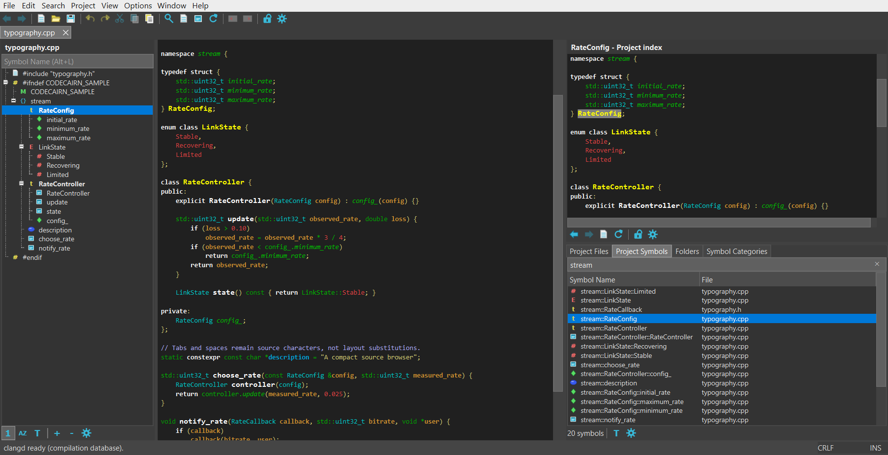

# CodeCairn - inspired by Source Insight


**Find your way through code.**

A desktop source browser and editor. Navigate symbols, preview definitions,
and find references without losing your place.



[User guide](docs/USER_GUIDE.md) | [Developer guide](docs/DEVELOPER_GUIDE.md) |
[Repository](https://github.com/deepak-rawat/codecairn) | [MIT license](LICENSE)

## Build and run

Requires CMake 3.24+, Ninja, a C++20 compiler, Qt 6.5+ (including Core5Compat
and Qt Test; Linux bundling needs 6.7+), Tree-sitter 0.25+ (grammar ABI 14/15),
SQLite, RE2, and libclang.
Install clangd for compiler-aware C/C++ navigation.
The first configure downloads pinned Scintilla and grammar sources.

```sh
git clone https://github.com/deepak-rawat/codecairn.git
cd codecairn
```

### Windows: MSYS2 UCRT64

Run in the **UCRT64 terminal**:

```sh
pacman -S --needed mingw-w64-ucrt-x86_64-gcc \
    mingw-w64-ucrt-x86_64-cmake mingw-w64-ucrt-x86_64-ninja \
    mingw-w64-ucrt-x86_64-qt6-base mingw-w64-ucrt-x86_64-qt6-5compat \
    mingw-w64-ucrt-x86_64-libtree-sitter mingw-w64-ucrt-x86_64-sqlite3 \
    mingw-w64-ucrt-x86_64-re2 mingw-w64-ucrt-x86_64-clang \
    mingw-w64-ucrt-x86_64-clang-tools-extra
cmake -S . -B build -G Ninja -DCMAKE_BUILD_TYPE=Debug -DCMAKE_C_COMPILER=gcc -DCMAKE_CXX_COMPILER=g++
```

### Linux: Debian/Ubuntu

Use a recent distribution whose packages meet the requirements above:
Ubuntu 24.04 needs the Qt SDK and pinned Tree-sitter setup described in the
[Linux release instructions](docs/RELEASING.md#ubuntu-2404-x64-linux).

```sh
sudo apt install build-essential cmake ninja-build qt6-base-dev \
    qt6-5compat-dev libtree-sitter-dev libsqlite3-dev libre2-dev \
    libclang-dev llvm-dev clangd
cmake -S . -B build -G Ninja -DCMAKE_BUILD_TYPE=Debug
```

### macOS: Apple Silicon, macOS 26+

```sh
brew install cmake ninja qt tree-sitter sqlite re2 llvm
cmake -S . -B build -G Ninja -DCMAKE_BUILD_TYPE=Debug
```

### Build, test, and launch

After configuring for your platform:

```sh
cmake --build build --parallel
ctest --test-dir build --output-on-failure
```

| Platform | Run from the project directory |
|---|---|
| Windows (MSYS2 UCRT64 shell) | `./build/bin/codecairn.exe` |
| Linux | `./build/codecairn` |
| macOS | `./build/codecairn.app/Contents/MacOS/codecairn` |

Keep runtime files beside the Windows executable and dependencies installed
on Linux/macOS. Do not reuse a build directory with a different toolchain.
Windows has local runtime-test coverage; Linux/macOS still need native certification.

See the [user guide](docs/USER_GUIDE.md) for usage and troubleshooting, and the
[developer guide](docs/DEVELOPER_GUIDE.md#build-system) for build options and offline builds.

## Packages and releases

See the [release guide](docs/RELEASING.md) for standalone Windows ZIP, macOS DMG,
Ubuntu 24.04+ x64 Linux TAR packages, pinned sources, and Homebrew/MSYS2/Arch recipes.
GitHub Actions builds and tests packages before creating a draft release;
publication remains manual. Package installation, runtime, signatures, checksums
and provenance are verified manually; CI has no package-validation tests.
Performance fixtures run in a separate manually dispatched workflow.
