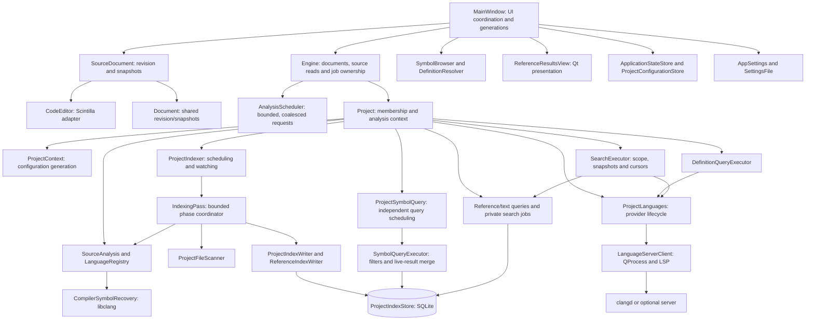
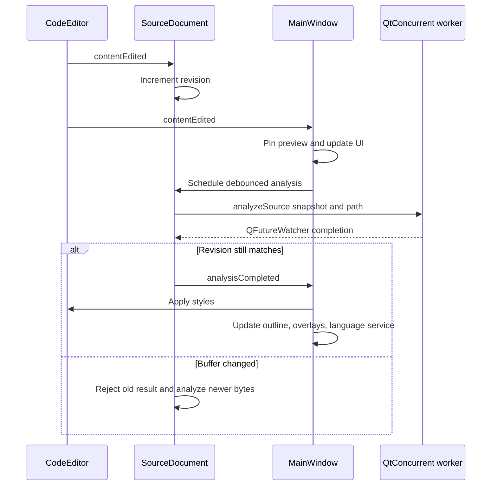
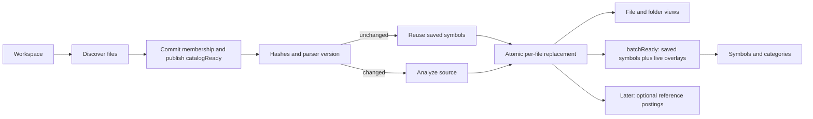
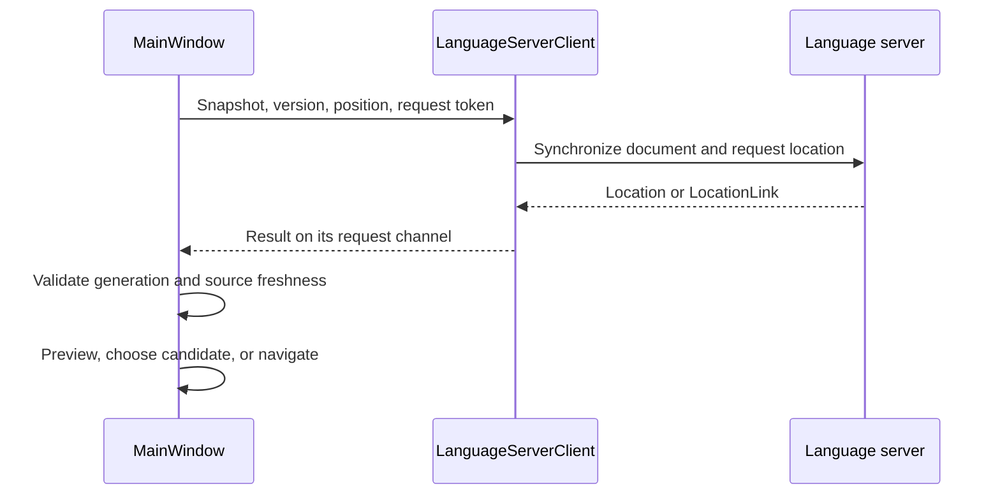

# CodeCairn developer guide

This is the single guide for learning and maintaining the codebase. Start with
[Getting started](#getting-started) if you are new to the project or Qt; use the
later sections as the implementation reference. The [README](../README.md) covers
setup and quick usage; the [user guide](USER_GUIDE.md) explains features and every
group of UI options. Project-wide coding-assistant conventions are in
[AGENTS.md](../AGENTS.md).

[Getting started](#getting-started) | [Qt concepts](#qt-concepts) |
[Architecture](#architecture-and-code-map) | [UI](#ui-and-interaction-model) |
[Data flows](#data-flows) | [Storage](#storage-and-settings) |
[Build system](#build-system) | [Testing](#testing-and-debugging) |
[Making changes](#making-changes)

## Getting started

### Build and explore

CodeCairn is a C++20 Qt Widgets application using upstream Scintilla's Qt wrapper. Follow the
[platform setup](../README.md#build-and-run) before configuring. On Windows, keep
the compiler, Qt, and libraries in the MSYS2 UCRT64 toolchain; do not mix UCRT64
and MINGW64 or reuse a build directory configured with another compiler.

Command examples use Bash/zsh, including MSYS2 UCRT64 on Windows.
Configure using the README's platform options, also adding
`-DCMAKE_EXPORT_COMPILE_COMMANDS=ON`, then run from the project directory:

```sh
cmake --build build --parallel
ctest --test-dir build --output-on-failure -R '^(configuration|interactions)$'
```

Use the default build or `--target deploy` for a runnable bundled Windows tree:
building only `--target codecairn` skips deployment. Keep the accompanying DLLs,
plugins, `qt.conf`, and Clang resource headers with the executable. Linux/macOS
commands and executable locations are in the README. For disconnected builds,
see [Offline builds](#offline-builds).

### A ten-minute UI tour

1. Open a folder through **Project > Open Folder** and wait for indexing.
2. Filter Project Files and select a file. Browse another file to observe reuse
   of a clean preview tab; Enter, double-click, or editing pins it.
3. Select an outline symbol, then click inside a different function in source.
   Notice the difference between navigating from the outline and the outline
   following the editor without moving its caret.
4. Open Project Symbols and try fragments such as `doc write`, a function-only
   query such as `open(`, and an RE2 expression such as `?^parse.*`.
5. Browse Folders and Symbol Categories. Inspect the context preview without
   activating the source file.
6. Lock context and move the caret; unlock it to resume tracking.
7. Run Lookup References using Text Occurrences first, which needs no server.
   Try result selection, source-link icons, Ctrl+L, and next/previous reference.
8. Try Replace all results, then explicitly close the results tab: closing it
   resets its searches, whereas quitting with it open preserves completed groups.
9. Type in a panel filter, browse its list, then press Escape or leave the panel.
10. Use Go Back and Go Forward to inspect editor navigation history.

For semantic browsing, enable compilation database export in the project being
browsed and select its build directory through
**Project > Compilation Database Directory**. This project's own build database
does not describe other workspaces.

### Suggested reading order

Follow one complete user interaction rather than reading the largest parser
implementation line by line.

| Pass | Read | Goal |
|---|---|---|
| 1 | [main.cpp](../src/ui/main.cpp), [MainWindow.h](../src/ui/MainWindow.h) | Startup and ownership |
| 2 | `buildUi()` in [MainWindowUi.cpp](../src/ui/MainWindowUi.cpp) | Map visible controls to widgets |
| 3 | [CodeEditor.cpp](../src/ui/CodeEditor.cpp), [SourceDocument.cpp](../src/ui/SourceDocument.cpp) | Buffer events, revisions, snapshots, workers |
| 4 | [SourceAnalysis.h](../src/core/include/codecairn/SourceAnalysis.h), [SourceTypes.h](../src/core/include/codecairn/SourceTypes.h) | Styles, symbols, coordinates, and provenance |
| 5 | [MainWindowNavigation.cpp](../src/ui/MainWindowNavigation.cpp) | Preview, activation, focus, and safe targets |
| 6 | [MainWindowReferences.cpp](../src/ui/MainWindowReferences.cpp), [ReferenceTests.cpp](../tests/ui/ReferenceTests.cpp) | Trace a complete asynchronous feature |
| 7 | [Project.h](../src/core/include/codecairn/Project.h), [MainWindowWorkspace.cpp](../src/ui/MainWindowWorkspace.cpp) | Project queries and live document snapshots |
| 8 | Parser, compiler, and language-server implementations | Study internals as a change requires |

Before changing behavior, be able to answer: which widget starts it, who owns
the state, which signal connects it, what runs asynchronously, how stale work is
rejected, and which test proves the result?

## Qt concepts

### Application, widgets, and layouts

[main.cpp](../src/ui/main.cpp) creates `QApplication`, sets application identity and
worker limits, parses arguments, constructs the window, opens startup paths,
and enters `app.exec()`. The event loop dispatches input, timers, painting,
process output, and worker completions. Blocking a handler with parsing or a
filesystem scan prevents other UI work.

`QMainWindow` supplies menus, toolbars, a central widget, and a status bar.
`QVBoxLayout` and `QGridLayout` arrange controls; `QSplitter` provides resizable
regions; `QTabWidget` owns pages. The UI is constructed in C++ in
[MainWindowUi.cpp](../src/ui/MainWindowUi.cpp), not in a Designer `.ui` file.

### Signals, connections, and resources

A signal announces an event; a connected method or lambda handles it. Modern
typed connections do not require the receiver to be declared in a `slots:` block:

```cpp
connect(outlineFilter_, &QLineEdit::textChanged,
        this, &MainWindow::filterOutline);
```

The context object in a connection controls its lifetime. For example:

```cpp
connect(doc, &Document::analysisRejected, doc->editor,
        [this](const QString &error) {
            reportError(error);
            updateOutline();
            updateOpenSymbols();
        });
```

Qt disconnects this connection when its context is destroyed. Arbitrary raw
pointers captured by the lambda still need separate lifetime reasoning.
`Q_OBJECT` enables custom signals; CMake's AUTOMOC generates the meta-object code.
AUTORCC compiles [resources.qrc](../resources.qrc). Paths beginning `:/` refer to
embedded resources, not ordinary filesystem files.

`setObjectName("outline")` assigns a programmatic ID, not a visible label.
Tests use these IDs with `findChild`, and stylesheets can select them. Treat
widget/action IDs as contracts rather than cosmetic names.

### Ownership and useful types

| Type or pattern | Role |
|---|---|
| QObject parent | Parent destruction deletes its QObject children |
| `std::unique_ptr<SourceDocument>` | C++ ownership of document records |
| `QPointer<QWidget>` | Non-owning pointer cleared when the QObject is destroyed |
| `QByteArray` | UTF-8 source bytes, hashes, or style bytes |
| `QString` | UI text and paths, indexed in UTF-16 code units |
| `QVector<T>`, `QHash<K,V>` | Result collections and lookup tables |
| `QSignalBlocker` | Suppresses callbacks during programmatic view updates |
| `QFutureWatcher<T>` | Delivers asynchronous completion to the owning side |

The tab hierarchy owns editor widgets. SourceDocument owns presentation state,
its reload watcher and debounce timer; Engine owns source Documents and analysis
workers. MainWindow coordinates the bindings. Closing a source tab cancels its
analysis, unbinds the byte provider and releases the Engine document before
deleting the editor.

A nested event loop does not freeze the rest of the application. Results menus
use parent-owned heap menus with `popup()` and deferred deletion, not a stack
menu parented to a view with `exec()`: closing that view could otherwise delete
the stack menu. Modal export/timestamp dialogs also revalidate page lifetime
before using widgets or applying changes.

## Architecture and code map



Three analysis technologies have distinct responsibilities:

| Technology | Used for | Does not establish |
|---|---|---|
| Tree-sitter | Styling, outlines, syntax-symbol extraction | Compiler-resolved types or overloads |
| libclang | Selective C/C++ recovery and inactive-region analysis | A continuously running language server |
| clangd | Compiler-aware C/C++ definitions and references | Readiness of the separate SQLite catalog |

A completed catalog rebuild does not imply that the server has indexed every
translation unit. A same-named syntax symbol is a candidate, not proof of identity.

### Code map

All `MainWindow*.cpp` files implement the **same class**, declared in
[MainWindow.h](../src/ui/MainWindow.h). They split UI responsibilities; they are not
separate controllers.

| Area | Entry points |
|---|---|
| Startup and command-line paths | [main.cpp](../src/ui/main.cpp) |
| Window, document UI, outline, context, open/save/close | [MainWindow.cpp](../src/ui/MainWindow.cpp) |
| Widget hierarchy, actions, menus, toolbars, enablement | [MainWindowUi.cpp](../src/ui/MainWindowUi.cpp) |
| Workspace services, browser integration, definition previews | [MainWindowWorkspace.cpp](../src/ui/MainWindowWorkspace.cpp) |
| Preview tabs, focus, asynchronous navigation reads, history | [MainWindowNavigation.cpp](../src/ui/MainWindowNavigation.cpp) |
| Hover links and explicit definition jumps | [MainWindowLinks.cpp](../src/ui/MainWindowLinks.cpp) |
| Search dialog, orchestration, replacement, results lifecycle | [MainWindowReferences.cpp](../src/ui/MainWindowReferences.cpp) |
| Preferences and per-panel options | [MainWindowSettings.cpp](../src/ui/MainWindowSettings.cpp), [MainWindowPanels.cpp](../src/ui/MainWindowPanels.cpp) |
| Document revisions, snapshots, analysis, external reload | [SourceDocument.h](../src/ui/SourceDocument.h), [SourceDocument.cpp](../src/ui/SourceDocument.cpp) |
| Text, selections, undo, styles, source-link margin | [CodeEditor.h](../src/ui/CodeEditor.h), [CodeEditor.cpp](../src/ui/CodeEditor.cpp) |
| Parsing, language selection, compiler recovery | [SourceAnalysis.cpp](../src/core/SourceAnalysis.cpp), [LanguageRegistry.cpp](../src/core/LanguageRegistry.cpp), [CompilerSymbolRecovery.cpp](../src/core/CompilerSymbolRecovery.cpp) |
| Project-owned provider lifecycle | [ProjectLanguages.cpp](../src/core/ProjectLanguages.cpp) |
| Public domain ownership and project queries | [Engine.cpp](../src/core/Engine.cpp), [Project.cpp](../src/core/Project.cpp), [Document.cpp](../src/core/Document.cpp) |
| Analysis execution and context/cache ownership | [AnalysisScheduler.cpp](../src/core/AnalysisScheduler.cpp), [ProjectContext.cpp](../src/core/ProjectContext.cpp), [ProjectAnalysisCache.h](../src/core/internal/ProjectAnalysisCache.h) |
| Definition and text/reference execution | [DefinitionQueryExecutor.cpp](../src/core/DefinitionQueryExecutor.cpp), [SearchExecutor.cpp](../src/core/SearchExecutor.cpp) |
| Index scheduling, watchers, cancellation | [ProjectIndexer.cpp](../src/core/ProjectIndexer.cpp) |
| Discovery, indexing phases, query scheduling/execution | [ProjectFileScanner.cpp](../src/core/ProjectFileScanner.cpp), [IndexingPass.cpp](../src/core/IndexingPass.cpp), [ProjectSymbolQuery.cpp](../src/core/ProjectSymbolQuery.cpp), [SymbolQueryExecutor.cpp](../src/core/SymbolQueryExecutor.cpp) |
| SQLite and path identity | [ProjectIndexStore.cpp](../src/core/ProjectIndexStore.cpp), [Paths.cpp](../src/core/Paths.cpp) |
| Browser rows and syntax fallback | [SymbolBrowser.cpp](../src/ui/SymbolBrowser.cpp), [DefinitionResolver.cpp](../src/core/DefinitionResolver.cpp) |
| LSP, compilation database, coordinate conversion | [LanguageServerClient.cpp](../src/core/LanguageServerClient.cpp), [CompilationDatabase.cpp](../src/core/CompilationDatabase.cpp), [SourceCoordinates.cpp](../src/core/SourceCoordinates.cpp) |
| Typed search options, matching, semantic result resolution | [SearchOptions.h](../src/core/include/codecairn/SearchOptions.h), [ReferenceQuery.cpp](../src/core/ReferenceQuery.cpp), [ReferenceSearch.cpp](../src/core/ReferenceSearch.cpp) |
| Candidate postings, history validation/export, text caret | [ReferenceCandidateIndex.cpp](../src/core/ReferenceCandidateIndex.cpp), [ReferenceHistory.cpp](../src/core/ReferenceHistory.cpp), [ReferenceResultsView.cpp](../src/ui/ReferenceResultsView.cpp) |
| Preferences, window/session state, workspace options | [AppSettings.cpp](../src/ui/AppSettings.cpp), [ApplicationStateStore.cpp](../src/core/ApplicationStateStore.cpp), [ProjectConfigurationStore.cpp](../src/core/ProjectConfigurationStore.cpp) |
| File safety, shared limits, appearance | [FileIO.cpp](../src/core/FileIO.cpp), [RuntimeLimits.h](../src/core/include/codecairn/RuntimeLimits.h), [UiAppearance.cpp](../src/ui/UiAppearance.cpp) |

MainWindow aliases `SourceDocument` as `Document`. Its important state is:

```text
editor                    live Scintilla buffer
path / hasUtf8Bom          disk identity and BOM information
savedBytes / saved hash    saved-content identity
revision                  version of current live text
analyzedRevision          version described by accepted analysis
analysis                  styles, symbols, diagnostics
private timers/watchers   debounce, analysis, reload lifecycle
isPreview                 whether the editor tab can be reused
outline keys / scroll     remembered selection and expansion
snapshotBytes() / hash    revision-cached asynchronous input
```

The editor buffer is authoritative while editing. A disk file, saved index row,
or context snapshot is not automatically the same version of that text.

### Responsibility and naming rules

- Keep UI focus, selection, and presentation generations in MainWindow.
  Document owns revisions and cached snapshots. Each Project owns its analysis
  context; SourceDocument binds shared text to the editor, caches accepted
  presentation results and applies external reloads.
- [SourceTypes.h](../src/core/include/codecairn/SourceTypes.h) and [IndexTypes.h](../src/core/include/codecairn/IndexTypes.h) hold
  shared result data; [SourceCoordinates.h](../src/core/include/codecairn/SourceCoordinates.h) defines LSP
  locations and explicit coordinate conversion.
- Keep language identity typed as `LanguageId`.
- Use purpose-specific names and named item roles such as `SymbolItemRole`.
  Preserve symbol/category/provider strings, widget IDs, JSON keys, and parser
  identities unless a deliberate contract change requires otherwise.
- Reuse existing facades and helpers; do not add a generic plugin/controller
  framework to split a single responsibility.

### Headless core boundary

Sources follow the build boundaries: `src/core/` contains headless services and
shared types, `src/ui/` contains Qt presentation plus the GUI and launcher entry
points, and `src/cli/` contains the headless CLI entry point. Supported core
headers live in `src/core/include/codecairn/` and are included as
`<codecairn/Engine.h>`. Only `src/core/include/` is exported. Engine/storage
implementation headers live in `src/core/internal/`; only the core and explicitly
selected white-box tests can include them. The UI also inherits public core headers.

`codecairn_core` contains public data types and nonvisual functionality. It links
Qt Core/Concurrent, grammars, Tree-sitter, libclang, SQLite, and RE2, but not Qt
Gui/Widgets, Scintilla, appearance settings, or GUI resources. There is no separate
domain/backend library. `codecairn_ui_qt` contains the existing Qt presentation,
and both the GUI and `codecairn-cli` use the core.

- [ProjectSession.cpp](../src/core/ProjectSession.cpp) prepares validated projects and
  compilation settings before the UI commits a project switch after its prompts.
  [Project](../src/core/include/codecairn/Project.h) owns its configuration,
  index and analysis context. Preparation does not replace the active project;
  frontends open only after save/discard/cancel decisions succeed.
- [ProjectDiscovery.cpp](../src/core/ProjectDiscovery.cpp) implements shared project
  inclusion/exclusion and cancellable file discovery. The dialog owns view
  updates and observes snapshot-based scan results.
- [Document.cpp](../src/core/Document.cpp) encapsulates source identity, revisions,
  saved contents and lazy snapshots. SourceDocument binds Scintilla as its live
  byte provider, without a second per-keystroke mutable buffer. Analysis results
  belong to the requesting project, not to the shared document.
- [NavigationTarget.cpp](../src/core/NavigationTarget.cpp) validates ranges/hashes;
  Engine alone owns asynchronous source reads. DefinitionQueryExecutor accepts
  typed DefinitionQuery/RequestId inputs and returns public DefinitionPage
  results directly. It owns semantic policy, self-target filtering, freshness
  checks and syntax fallback, not source reading or UI navigation channels.
  Applicable cross-file unsaved document snapshots are captured automatically.
- SearchExecutor owns separate text/reference entry points, scoped source
  capture, provider dispatch, pagination, cursor validity and cancellation.
  One immutable input set is captured per search, not recaptured during startup
  or between pages. Each semantic search has its own internal protocol channel.
  Snapshot providers run on the owning thread, never a worker. Project routes
  public results without maintaining another search/session map.
- AnalysisScheduler owns bounded execution and pending-request coalescing.
  Each Engine uses two analysis workers, admits at most 130 submitted/undelivered
  jobs and 512 subscribers, and reports overload asynchronously as
  "Analysis queue is full; retry after pending work completes." Equivalent
  in-flight requests share parsing only when project, context generation, path,
  revision, supplied hash, detail and compilation directory match; source bytes
  are compared as a collision guard. Cancelling a subscriber does not cancel
  another subscriber's result. A queued job with no subscribers skips parsing.
  These limits bound admitted parsing work, not deferred error notifications
  from an arbitrary synchronous flood of rejected requests.
  ProjectAnalysisCache accepts only matching current document identities.
  Full styling analysis is not overwritten by symbol-only analysis of the same
  revision. Cache entries remain bounded by open documents and are discarded
  on document close or project-context invalidation.
- ProjectContext owns validated identity/configuration, the prepared compilation
  directory and analysis generation. Manual reopening with changed configuration
  invalidates obsolete analysis just like explicit reload/restart.
  Invalid configuration leaves the existing context intact and reports an error.
  Active language providers restart with changed settings; manual contexts stop
  obsolete providers rather than using their previous compilation settings.
- ReferenceHistoryModel owns append/replacement limits, staging and rollback on
  persistence failure. Presentation labels, source links, close/quit interaction
  and confirmation prompts remain frontend responsibilities.

Core services require a running Qt event loop and are called on their owning
thread. Keep requests/results implicitly shared and in-process: no JSON
serialization between the GUI and core. Queued work must not outlive its owner.
Call `configureStateDirectory()` only during startup, before any services or
worker jobs; it changes the process-wide core storage root, not GUI preferences.

### Using the core API

[Engine](../src/core/include/codecairn/Engine.h),
[Project](../src/core/include/codecairn/Project.h) and
[Document](../src/core/include/codecairn/Document.h) are the public domain objects
in namespace `codecairn`. Link to `codecairn_core` and use the owning thread's
QCoreApplication/QApplication event loop. Construction does not scan or launch
language servers. CoreSession is retired, not retained as another facade layer.

| Object | Responsibility | Main operations |
|---|---|---|
| Engine | Runtime and identity/lifetime of projects and documents | `openProject`, `openDocument`, `createDocument`, `closeDocument`, `readSource` |
| Project | Membership, compiler configuration and analysis/index/query context | `open`, `refreshIndex`, `findSymbols`, `findDefinitions`, `findReferences`, `searchText`, `analyze` |
| Document | Project-independent current/saved bytes and revisions | `updateContents`, `snapshot`, `position`, `setSavedContents` |

One open source path has one Document per Engine. Reopening or creating it again
returns the existing document without replacing unsaved contents. Projects share
its snapshots but keep their own analysis results and compilation configuration.
A document may be outside all projects. Closing a project does not close or save
documents. Engine destruction cancels work and releases everything it owns.

For an ordinary caller, use `engine.openProject(ProjectSpec::folder(path), options)`
or `ProjectSpec::managed(projectFile)` and check its Result<Project*>.
The reusable `createProject()` / `Project::open()` path below lets a GUI connect
progress handlers before opening, and prepare settings before prompting about
unsaved files. ProjectInfo exposes identity/configuration, not implementation
services. SymbolQuery has filter/page fields; source overlays, database identity
and pending-schema handling are captured internally.

Use the named index modes for `Project::refreshIndex()` and the advanced synchronous
`buildProjectIndex()` entry point in [Indexing.h](../src/core/include/codecairn/Indexing.h):

- `DiscoverChanges`: rediscover files and reuse unchanged analysis.
- `ReparseKnownFiles`: reparse the current catalog without discovering new files.
- `RebuildFilesAndSymbols`: rediscover and reparse.
- `CheckKnownFiles`: check/reuse known files without discovery or forced parsing.

ProjectOptions independently names index and language startup as `Automatic`
or `Manual`. Manual mode does not start that work; switching projects stops old
services rather than allowing them to remain attached to a different root.
Prepare first, obtain any frontend save/discard/cancel decision, then open.
Invalid preparation/open leaves the current project and its requests intact.
Successful project switches and close cancel project requests before changing
services. Reopening the same project in manual mode
does not invalidate existing requests.

This complete example opens a project, waits for indexing, and queries symbols.
Configuration/storage errors and asynchronous indexing/query errors remain visible:

```cpp
#include <codecairn/Project.h>
#include <QCoreApplication>
#include <QDebug>

int main(int argc, char **argv) {
    QCoreApplication app(argc, argv);
    app.setApplicationName("CoreExample");
    if (app.arguments().size() != 2) {
        qCritical() << "Expected a workspace directory";
        return 2;
    }
    codecairn::Engine engine;
    auto *project = engine.createProject();
    QObject::connect(project, &codecairn::Project::failed, &app,
                     [&](const QString &error) {
                         qCritical().noquote() << error;
                         app.exit(1);
                     });
    QObject::connect(project, &codecairn::Project::indexReady, &app,
                     [&](codecairn::RequestId, const IndexResult &) {
                         codecairn::SymbolQuery query;
                         query.text = "parse";
                         project->findSymbols(query);
                     });
    QObject::connect(project, &codecairn::Project::symbolsReady, &app,
                     [&](codecairn::RequestId, const SymbolPage &page) {
                         if (!page.error.isEmpty()) {
                             qCritical().noquote() << page.error;
                             app.exit(1);
                         } else {
                             qInfo() << page.total << "matches";
                             app.quit();
                         }
                     });
    const auto prepared = prepareProject(app.arguments()[1]);
    const codecairn::ProjectOptions startup{
        codecairn::IndexStartup::Automatic, codecairn::LanguageStartup::Manual};
    const auto opened = project->open(prepared, startup);
    if (!opened) {
        qCritical().noquote() << opened.error().message;
        return 1;
    }
    return app.exec();
}
```

This standalone reference example searches one file and consumes all pages:

```cpp
#include <codecairn/Project.h>
#include <QCoreApplication>
#include <QDebug>
#include <QTimer>

int main(int argc, char **argv) {
    QCoreApplication app(argc, argv);
    if (app.arguments().size() != 2)
        return 2;
    codecairn::Engine engine;
    auto *project = engine.createProject();
    codecairn::TextQuery query;
    query.files.scope = codecairn::SearchScope::CurrentFile;
    query.files.currentFile = canonicalPath(app.arguments()[1]);
    query.text = "parse";
    QObject::connect(project, &codecairn::Project::textMatchesReady, &app,
                     [&](codecairn::RequestId, const codecairn::SearchPage &page) {
                         if (!page.error.isEmpty()) {
                             qCritical().noquote() << page.error;
                             app.exit(1);
                         } else if (page.cancelled) {
                             app.exit(130);
                         } else {
                             qInfo() << page.hits.size() << "matches on this page";
                             if (page.next)
                                 project->continueSearch(page.next);
                             else
                                 app.quit();
                         }
                     });
    QTimer::singleShot(0, project, [&] { project->searchText(query); });
    return app.exec();
}
```

Every query returns an Engine-generated RequestId. Use `project->cancel(id)` to
abandon project work, or `engine.cancel(id)` for source reads/standalone analysis.
Project cancellation is owner-scoped: passing another project's request ID cannot
cancel that project's analysis. Separate semantic definitions and reference
searches use independent protocol requests, so one does not supersede another.
No caller-generated token or frontend-specific channel string is needed.
SearchCursor is an opaque continuation of the captured search, not an offset to
apply to unrelated results. It becomes invalid on source changes, cancellation,
or project close. `findReferences` takes a SourcePosition and an explicit
ReferenceResolution; `searchText` takes text and matching options. Semantic-only
queries never fall back to syntax or text.

For unsaved contents, open/create a Document then call `updateContents(bytes)`.
Project queries capture its current snapshot automatically. `Engine::analyze()`
analyzes standalone text; `Project::analyze()` uses that project's compilation
settings. AnalysisResult contains the exact source revision it describes; a shared
document never stores one project's semantic analysis as universally valid.
AnalysisDetail selects `Symbols` or `StylesAndSymbols`, not a frontend-specific
"editor" mode; symbol-only analysis avoids allocating style bytes.
The CLI and [CoreTests.cpp](../tests/core/CoreTests.cpp) show
executed end-to-end examples, including navigation requests and live documents.

`IndexUpdate` is the canonical namespaced indexing policy, not an alias to an
older global enum. `SymbolQuery` is the normal frontend query passed to
`Project::findSymbols()`. The lower-level `SymbolCatalogQuery` describes a
captured catalog read: overlays, descriptor, paging, counts and cancellation.
It is deliberately public because bounded virtual symbol/category models and
index-parity fixtures use independent catalog reads rather than the project's
single latest-query channel. It is not an ostensibly private `detail` type
leaking through public headers. These reads remain implemented in the core;
frontend models own only presentation, page caching and scheduling.

#### Lifetime, threading and result contracts

- Returned project/document pointers are borrowed. Engine owns them; use its
  close operations, not `delete` or QObject reparenting. `Project::close()` releases
  its active context while retaining the reusable Project object. Engine's
  `closeProject(pointer)` releases the object itself. GUI SourceDocument is only
  a presentation binding; it does not own another source buffer.
- All service calls, snapshot providers and result delivery run on the owning
  event-loop thread. Workers receive snapshots, never widgets or document pointers.
  A Document byte provider is called synchronously and lazily, once per requested
  revision; unbind it before its editor is destroyed. Use a QObject context on
  signal connections.
- Requests/results retain Qt implicit sharing. Do not copy source bytes manually,
  convert them through JSON, or introduce another worker hop to call these APIs.
  UTF-8 byte ranges and UTF-16 LSP coordinates keep their existing conversions.
- Connect before starting. Async operation results are delivered after the start
  call returns, including deferred validation failures. Open/close operations
  return Result<T> immediately; check it before calling value() or error().
  Check result errors before accepting query data. Zero matches is success.
  A nonempty next cursor means another search page; symbol pages expose totals.
  Semantic-only requests never silently become syntax/text results.
- Request IDs distinguish concurrent definitions/searches and page requests.
  Symbol browsing has one coalesced latest query per project, preserving bounded
  refresh work. Cancelling invalidates late
  completions; no cancellation completion signal is promised. Already delivered
  frontend results remain frontend-owned.
- Destroy Engine before QApplication. It joins owned jobs and can wait for a
  noninterruptible parser. Documents have encapsulated state and no independent
  analysis worker or terminal "stop" mode. Each project's results carry their
  own context and source identity.

## UI and interaction model

The [fixture screenshot](images/codecairn-overview.png) shows the regions:

```text
QMainWindow
+------------------+------------------------+-------------------------+
| Menu bar, main toolbar, separate documentBar_ tab strip             |
+------------------+------------------------+-------------------------+
| Symbol Window    | documentsTabs_         | Context preview         |
| title + filter   | CodeEditor pages       | title + chooser         |
| outline tree     | or Search Results      | read-only CodeEditor    |
| outline toolbar  |                        | context toolbar         |
|                  |                        +-------------------------+
|                  |                        | Project Files / Symbols |
|                  |                        | Folders / Categories    |
+------------------+------------------------+-------------------------+
| Status bar                                                         |
+--------------------------------------------------------------------+
```

`mainSplitter_` divides the horizontal regions; `rightSplitter_` divides context
from the browser. A separate `QTabBar` supplies the visible document strip.
The built-in `QTabWidget` tab bar is hidden, and selected indices are connected
both ways. Search Results is a page, **not a source document**; `activeEditor()`
can legitimately return null.

### Outline and temporary filters

`updateOutline()` maps analysis parent indices to `QTreeWidgetItem` children.
Rows store symbol index, kind, line, and a stable key. Expansion, selection,
and scroll state survive rebuilds; blockers prevent partial construction from
triggering navigation.

`syncOutlineToEditor()` selects the innermost visible symbol for the editor
selection, expands parents, and reveals it without moving the caret, taking
focus, or recording a jump. It waits for accepted analysis when necessary.
Passive reanalysis preserves remembered outline state when there is no new
selection target; explicit editor selection can clear an outside-symbol match.

The outline, Project Files, and Project Symbols filters are temporary. Typing
in a list routes text to its filter. Moving between the box and list preserves
the query; Escape, confirmation, leaving the panel, and history navigation clear
it. Confirmation means Enter or double-click, not a single-click browse.
Project-symbol confirmation waits for the latest filtered query; clearing the
filter cancels queued navigation. Preserve the chosen row when restoring the
full list.

When results are active, the outline instead lists searched queries. Selecting
one reveals its matches in context; Delete removes that query's result groups.

### Browsers, actions, and context

| Region | Data and behavior |
|---|---|
| Project Files | `populateFiles()` builds path/size rows and folder hierarchy |
| Project Symbols | `updateOpenSymbols()` queries; `displaySymbols()` delegates to SymbolBrowser |
| Symbol Categories | Category order comes from SourceAnalysis; SymbolBrowser renders all children |
| Context | `updateContext()` chooses targets; `showContext()` loads and selects source |
| Search Results | ReferenceResultsView combines structured rows with a read-only QTextCursor |

The browsers use `QTreeWidget`, not a custom abstract item model.
NavigationTree distinguishes real keyboard selection from model refreshes.
Preview navigation retains panel focus; activation focuses/pins the editor.

`buildUi()` creates one `QAction` per operation and reuses it in menus/toolbars.
Wire creation, behavior, shortcuts, enablement, and focus together.
UiAppearance centralizes fonts, stylesheets, tree appearance, and original icons.
Panel options and configuration propagation belong in the existing window files.
The standalone document tab bar is left-aligned in its layout rather than
stretching across it, so native macOS tab centering cannot offset the first tab.

Context is a read-only CodeEditor. It can follow selected identifiers, show an
enclosing function, or be disabled. Semantic ambiguity can require a chooser.
Link activation must finish any mouse gesture forwarded to Scintilla before
navigation changes focus. Ctrl-click consumes both press and release; plain
context-link clicks forward both, preserving normal drag selection.
**Pinning a document** prevents preview-tab reuse; **locking context** prevents
automatic preview replacement. Editor jump history and context snapshot history
are separate and bounded.

## Data flows

### Opening a workspace

MainWindow normalizes the root, validates/initializes per-user storage, prepares
the normalized compilation database, starts indexing/services, and restores the
session. Switching roots invalidates obsolete work but does not automatically
close every existing editor.

Startup restores the last available workspace unless explicit paths override it.
Opening a first-time folder does not automatically open an example file.
Tests redirect/disable persistence and use isolated application identities.

### Editing and analysis



The default parse debounce is 180 ms in
[default-settings.json](../config/default-settings.json). Workers receive copied
snapshots/path data, never widget pointers. Revision checks are required:
same-length text replacement can invalidate analysis without changing byte count.
`applyStyles()` also checks array length, but that is not the freshness test.

`analyzeSource()` returns:

- One style byte per source byte.
- Symbols with full/name ranges, parents, kinds, categories, declaration/
  definition information, and provider provenance.
- Support, syntax-error, and recovery diagnostics.

The default `SourceAnalysisMode::Editor` preserves all of these results.
Bulk indexing selects `Index`: it preserves editor symbol extraction, including
compiler recovery, without allocating style bytes or resolving styling bindings.
`SyntaxOnly` remains available for explicit syntax-only analysis, not project
indexing. Editor analysis and semantic services retain their recovery behavior.
Missing parser identifiers must not become blank, zero-width symbol entries.

LanguageRegistry selects grammars; ambiguous headers are scored with both
C-family grammars. Each request has a private `AnalysisContext`. The analysis
stages include `extractSyntax()`, `qualifyAndStyleSymbols()`, `styleBindings()`,
and `recoverCompilerSymbolsIfNeeded()` in intentional order. Preserve traversal,
parent, binding, and enrichment semantics when refactoring.

Tree-sitter trees are rebuilt per snapshot; incremental tree reuse is not
implemented. Compiler recovery uses libclang with filtered analysis arguments,
not a compiler-driver subprocess. Generated declarations retain invocation
ranges, and syntax/recovery limitations remain visible.

### Coordinate contracts

```text
Scintilla / Tree-sitter / source symbols: UTF-8 byte offsets
QString / results QTextCursor:          UTF-16 code units
LSP:                                   zero-based line + UTF-16 character
Displayed line labels:                 normally one-based
Ranges:                                end-exclusive [start, end)
```

An accented character can use two UTF-8 bytes; an emoji can use two UTF-16 code
units. Neither visible-character counts nor QString indexes are source byte
offsets. Use `lspPosition()` and `sourceByteOffset()` in
[SourceCoordinates.cpp](../src/core/SourceCoordinates.cpp); invalid boundaries are errors.
Styling must preserve bytes, BOM, selections, undo, and dirty state.

### Indexing and symbol queries



Project directly owns ProjectIndexer, ProjectSymbolQuery and ProjectLanguages.
There is no intermediate WorkspaceServices/service locator. The indexer only
owns update scheduling, watches, cancellation and progress; it does not schedule
symbol queries or manage language servers. ProjectSymbolQuery has its own bounded
worker, coalescing and generation checks; index busy state controls pending-schema
handling but does not prevent interactive queries. Closing/switching a project
invalidates both components independently. Explicit index recreation also
cancels/drains queries before archiving the database.

IndexingPass explicitly coordinates discovery, catalog reconciliation, symbol
preparation/commit and reference acceleration. Discovery completes before missing paths are
deleted. Managed-project membership is applied during discovery, including
pruning unselected directories; existing directory-name exclusions still apply.
`catalogReady(QStringList)` publishes the completed catalog before parsing.

Indexing uses a dedicated low-priority coordinator and a private syntax parser
pool bounded by available threads and eight workers. At most twice that worker
count of file results is outstanding. Workers exchange snapshots/results, never
widgets or SQLite connections. The coordinator is the single writer; each file's
metadata and symbols commit atomically through ProjectIndexWriter. The pass
handles scheduling and progress, not SQL statements. The writer owns reusable
prepared statements and transaction boundaries. Previous symbols remain queryable until
their replacement commits, and a failed read/analysis retains the previous usable
snapshot. `batchReady()` publishes incremental completed work with throttled
notifications. WAL readers can query while indexing is busy.

Cancellation preserves completed file transactions; refreshing reuses their
hash/parser matches and resumes remaining work. An in-progress file replacement
finishes atomically; cancellation never rolls back earlier commits. Reference
acceleration runs after symbols become usable, with a second bounded parallel
read/hash/tokenization stage and a single ReferenceIndexWriter. It prepares
statements once per pass, skips identifier extraction and transactions when
content hash/posting version match, and atomically replaces changed postings.
It does not retain every project's source bytes/identifier sets in memory:
at most twice the worker count of prepared results is outstanding, released
as consumed. Disk contents are still read and hashed on warm runs.
Reference cancellation rolls back the active posting transaction. Search retains
a full-search fallback for absent, incomplete, or stale postings. Discovery, symbol,
and reference phase timings and peak active parser counts are logged. Warning
collections are capped at 100, with an explicit suppressed count; per-analysis
syntax diagnostics are also bounded.
`FileIO.h` exposes `sourceContentHash(bytes)`, a reusable per-thread SHA-256
hasher returning lowercase hexadecimal without transforming its input. Bulk
parser threads and reference-preparation workers use it, resetting for every
file. This avoids repeated crypto-provider
setup without skipping content reads or weakening unchanged-metadata freshness
checks; stored hashes still describe the exact decoded source bytes.

Global editor work remains capped at two. Overlapping refreshes queue one
follow-up pass rather than cancelling the active pass. Notifications debounce
for 700 ms; the six-hour poll checks missed changes.
`behavior.workspaceRefreshMinutes` accepts 1-35791 minutes and
applies at startup/reload. Native watches are capped at 2,048 paths.

Directory notifications compare worker-side snapshots, exclude metadata/build
folders, and ignore directory timestamps. File notifications and polls still
verify content when size/mtime are unchanged. Unchanged automatic checks stay
quiet; manual refreshes and new warnings remain visible. Cancel pauses automatic
refresh until resumed. Cancellation is checked between files/stages, not inside
an active syntax parse; outstanding parser workers are drained before completion.

Live overlays replace disk symbols for open files but are not persisted as
saved contents. Clean external changes can reload; dirty buffers are preserved.
Internal lookup callers use bounded pages. Project Symbols requests a bounded
overview (4,097 rows plus global counts). Catalogs above 4,096 matching rows use
SymbolCatalogModel and the identically themed virtual view, with the full match
count as its row count. Category children virtualize independently when their
global count exceeds that threshold. Small catalogs retain SymbolBrowser and its
selection/expansion/scroll behavior. Optional category collections still cover the
full catalog for API callers unless categoryLimit explicitly bounds that collection.
There is no manual Load More Symbols step or loss of symbol coverage.

Virtual rows query 128 targets at a time on model-owned workers, retain at most 16
pages per model, and reject obsolete generations. They expose errors explicitly
and complete pending selection/activation when a row arrives. Closing a project or
recreating a database cancels and joins model readers before releasing the index.
Count-only updates discard cached offsets and cancel obsolete page reads;
subsequent requests load the current ordering rather than retaining stale offsets.
Completed and cancelled index passes invalidate cached pages. The cache bound concerns materialized targets,
not Qt's internal view geometry or total process RSS.
Global refreshes coalesce without repeatedly cancelling an identical active query;
user query/scope/revision changes still invalidate stale results. Progressive
refresh notifications are throttled separately from the user's search debounce.

SQL performs counts and bounded selection before materializing symbol records.
Exact-name context lookups use indexed name/qualified-name predicates and omit
unneeded global category aggregation. Dedicated index-query and page-reader pools
keep those scans from exhausting the shared editor/preview workers. ASCII fragment
matching uses escaped native SQLite LIKE predicates, with a Qt Unicode-matching
fallback for non-ASCII names. `%`, `_`, and backslashes in panel queries remain
literal fragments, not SQL wildcard syntax. The covering `symbol_catalog` index
contains the filtering/validity/order fields so broad scans avoid millions of
random full-record reads. Its leading columns follow the actual name/path/start
ordering, and paging selects row IDs before joining complete records. Category
counts use a separate covering index in grouping order; existing generated index
layouts are replaced transactionally when needed, without deleting symbol data.
Readers retain compatibility with an index that has
not yet acquired that additive index; schema initialization creates it.
Unicode and regex behavior retain
the original matching rules. Live overlays still override disk paths and sort
before same-named disk rows. Queries exclude empty names and zero-width name/source
ranges, including in older caches while reparsing.
Project-symbol navigation carries the indexed target through asynchronous file
opening and keeps that exact range in Context. Deferred caret notifications from
programmatic navigation must not reinterpret a macro invocation as a request to
preview its macro header. Newly opened clean buffers retain disk-index symbols
until editor analysis completes; dirty pending buffers still suppress stale disk
symbols. Applying later styles must not replace the explicit preview or its range.
Deferred activation records a persistent index and its open/preview intent, not
just a boolean. Selection changes invalidate that intent. Symbol-query summaries
can return the selected symbol's rank, allowing both virtual and small views to
restore the same path/name-range key after filtering without scanning every row.
Context also rejects a semantic result pointing back into the queried identifier
unless current source analysis identifies an actual declaration there. This avoids
clangd's implicit call-site declarations masquerading as definitions when headers
are unavailable. Genuine self-navigation at a declaration is retained. The indexed
fallback remains limited to managed membership; the UI explains unresolved scope
or compilation setup instead of silently indexing excluded dependencies.

C/C++ extraction includes both forward tags and typedef aliases, without
inventing declarations for ordinary tag uses. In editor analysis, macro-shaped
definitions can trigger compiler recovery even when syntax parsing succeeds. Recovered
definitions replace misidentified invocation arguments instead of adding false
function names. Bump ParserVersion when saved extraction meaning changes.

### Navigation and definition lookup

`navigateTo()` and `commitNavigation()` form the shared navigation path:

1. Capture origin/focus and advance the navigation generation.
2. Reuse an open document or read the destination asynchronously.
3. Reject obsolete work and validate expected source hashes/ranges.
4. Reuse a clean preview tab or create a document.
5. Select the target and record editor history.
6. Retain panel focus for browsing or focus/pin on activation.

Editing a preview pins it. A dirty editor is never silently reused.
[NavigationHistory.h](../src/core/include/codecairn/NavigationHistory.h) defines locations with byte or
LSP ranges, expected hashes, scroll state, and reference-line selection.

Automatic context follows `updateContext()` -> `resolveDefinition()` ->
`handleDefinitions()`. Hover/jump follows `lookupLink()` -> `handleLocations()`
-> `navigateDefinition()`. Both routes use LanguageServerClient:



The client owns QProcess, JSON-RPC framing, IDs, timeouts, full-text document
synchronization, cancellation, and independent channels. clangd lookup prefers
the bundled executable where applicable, then PATH and the configure-time
installation. Project/user configuration and query-driver execution are disabled.

A failed definition lookup can offer explicitly unverified syntax candidates;
ambiguous candidates need a chooser. An enclosing declaration is not a fake
definition resolver. Hover cannot move the caret or revive a stale link.
Context snapshots must match live source before server lookup.

### Reference searches and results

Read [MainWindowReferences.cpp](../src/ui/MainWindowReferences.cpp) as a complete
feature walkthrough:

1. `lookupReferences()` captures the active/context/browser symbol and shows
   the dialog. Query, scope, file types, matching options, and output choices
   are validated. Combo boxes carry method enum data, not behavior tied to
   display order.
2. Starting a search cancels the old request, captures overlays and scoped paths,
   creates a shared cancellation flag, and advances `referenceToken_`.
3. Smart reference matching sends LSP `textDocument/references`; returned ranges
   are validated and deduplicated by canonical path/range through
   `resolveSemanticReferences()`. Provider failure never silently becomes text.
4. Other modes use `searchReferences()` in ReferenceQuery: literal, regex,
   keyword-expression, or whole-identifier matching. RE2 validates expressions;
   keyword parsing supports Boolean/grouped terms, proximity, variations, and
   fragments. Syntax styles implement comment/string filters.
5. Exact identifier searches can use ReferenceCandidateIndex postings.
   Proven-negative files need fresh hashes before exclusion; dirty overlays
   remain candidates. Unicode queries conservatively bypass acceleration.
   This does not establish semantic identity or guarantee lower disk I/O.
6. Inactive C/C++ filtering uses libclang, compilation flags, and captured
   headers. Macro-dependent conditions need an exact compilation command;
   otherwise only unambiguous literal conditions can be filtered. Unsupported
   or uncertain regions are retained with warnings.
7. `displayReferenceHits()` updates structured groups and source links;
   ReferenceResultsView supplies a read-only QTextDocument/QTextCursor for
   caret movement, text selection/copy, and hover feedback.

Tokens and cancellation flags solve different problems. Cooperative workers
can still finish late; only the current token/page may accept a completion.
Both text and semantic results carry source snapshot identities.
The legacy `findTextOccurrences()` helper also remains used by focused
tests/benchmarks; it is not the complete UI search dispatcher.

Results have 10,000 matches per page, with explicit continuation. Previously
read/pruned sources are hash-checked between pages; changed buffers require a
new search rather than silently shifting offsets. History is bounded to 1,000
groups and 100,000 rows. Selecting a row previews its full referenced line;
link icons, Enter, and Ctrl+L activate navigation. The source-margin link returns
to the result. Next/previous reference also work from source.

Source/result icons share logical sizing; margin RGBA images must not use a
high-DPI pixmap's physical size as their logical dimensions. Red hover outlines
and the text caret are presentation only. Edits outside a linked range adjust
it; edits within the range mark it stale. External changes require hash checks.

**Result lifecycle is intentional:**

- Unchecked Replace all results appends groups.
- Checked replacement stages all pages, then saves and commits together.
  Failure, cancellation, stale source, limits, or a save error retains the old
  groups. A completed zero-match query is a valid replacement.
- Cancel Search invalidates work but retains completed groups.
- Explicitly closing the tab cancels work, clears completed/staged groups and
  link markers, and saves the empty history. The next search starts fresh.
- Quitting with the tab still open saves completed groups for workspace restore.
- Timestamp-touching starts off and requires confirmation; cancellation/page
  lifetime is rechecked before any modification.

Keep result pages out of source-document counts and source save/undo paths.
Do not lose groups merely because a newly created view has not yet received
a successful search; creation must reflect the current model. Shutdown stops
timers/services, invalidates work, disconnects callbacks, and joins owned futures
before document and Qt state can be destroyed.

## Storage and settings

### Source-file safety

[FileIO.cpp](../src/core/FileIO.cpp) accepts validated UTF-8, strips/remembers an optional
BOM, rejects binary/invalid encodings, and enforces the 4 MiB source limit.
CodeEditor detects CRLF on load. Saving uses QSaveFile atomic replacement and
checks external changes. Appearance changes must not rewrite source, alter undo,
clear dirty state, or replace dirty buffers in background.

### Persistent syntax index

SQLite schema version is **2**. New empty databases initialize transactionally;
legacy, nonempty unversioned, and newer schemas are explicitly rejected rather
than migrated or deleted. `ProjectIndexer::recreateDatabase()` is only called
after explicit UI confirmation. It cancels/drains its workers, obtains the
project index lock, rejects symlinked databases/journals, archives the database
and matching WAL/SHM journals with a unique backup suffix, and restarts the
current root/project scope. Lock/archive failures remain explicit errors.
ProjectSymbolQuery is separately cancelled and drained before this operation.
The reference tables are created when absent and carry a separate per-file
posting version.
Candidate readers check the schema version inside their read transaction. Before
the initial schema commits, they retain all source files
for a full search; a version-2 database with missing tables remains an error.

| Table | Purpose / fields |
|---|---|
| `files` | `path`, `hash`, `size`, `mtime`, `state`, `error`, `parser` |
| `symbols` | Names, kind/category, qualified/signature, definition flag, byte/name ranges, line, generated/provider |
| `reference_occurrence_files` | Indexed path/hash, posting version, ASCII-only flag |
| `reference_occurrences` | Per-file identifier and folded-identifier postings |

Deletion cascades through file-owned rows. Hashes describe decoded UTF-8 bytes
with the BOM removed. Paths use canonical/absolute identity; metadata/database
symlinks are rejected, and failures never redirect to another store.
ParserVersion is separate from schema/posting versions. Changes require tested
invalidation or migration, not silent database deletion.
The compiler-assisted index uses a bumped ParserVersion so syntax-only caches
are reparsed and macro-generated definitions are restored without deleting databases.
Managed descriptors select separate database identities through the optional
`projectFile` on `buildProjectIndex()`, `ProjectIndexer::open()`, and
`SymbolQuery`; folder and managed-project catalogs never share a store.
Existing databases must contain the complete required schema before indexing;
missing versioned tables/columns produce an error and require confirmed recreation,
rather than being silently re-created while old cached file states are reused.
Compiler recovery receives the project-specific normalized compilation directory
in index, editor, and disk-preview analysis; it must not discover another project's
whole-folder cache in preference to that explicit directory. New documents mark
analysis pending until the first result actually completes, including revision zero.
An explicitly supplied compilation directory is authoritative even when it has no
database: compiler recovery must not borrow a whole-folder cache. Managed
inactive-code filtering receives that same directory for both text and semantic
reference searches. Folder-mode callers without an explicit directory retain
automatic database discovery.

### Separate JSON configuration and state

| Store | Owns |
|---|---|
| Per-user `settings.json` or `--config` profile | Appearance, panel/search options, initial layout, debounce and refresh intervals |
| `state.json` | Window geometry, splitters, browser tab, last workspace |
| `workspaces/<workspace-hash>/session.json` | Ordered open files, active path, selections/scroll, completed search groups |
| `workspaces/<project-hash>/session-<root-hash>.json` | Root-specific managed-project session; changing the base folder does not reuse an incompatible session |
| `workspaces/<workspace-hash>/workspace.json` | Schema, canonical root, compilation directory, exclusions |
| `workspaces/<workspace-hash>/index.sqlite3` | Generated file/symbol catalog and reference postings |
| `workspaces/<workspace-hash>/clangd/` | Normalized compilation database and semantic caches |
| User-chosen `*.cairn` | Managed project's base folder, name, membership rules, and compilation/exclusion options |

`ProjectDialog` starts new projects without inheriting the active root or membership.
It receives the active AppSettings, uses UiAppearance's shared QTreeView styling,
and shows a lazy filesystem browser beside a model-backed list of actual included
files. Membership rules remain recursive; the right pane is a discovered preview,
not a replacement for folder rules. Removing individual files adds exclusions.
Discovery workers receive immutable root/options snapshots and cancellation flags,
publish bounded batches, and never access widgets. Generations reject obsolete
results, and changing scope also discards pending progress batches. Create/Save is
disabled until a current discovery pass completes without errors.

The new-project dialog contains the descriptor path and its explicit Browse action.
The suggested path uses Documents rather than the source base folder; the caller saves
directly after Create, without an implicit second file chooser. Editing an existing
project keeps its descriptor identity fixed and preserves the optimistic
projectFile/projectDigest tokens. Save failures reopen the same populated dialog
with inline errors instead of discarding the user's selection.

`--config` changes only the preferences path. Runtime state uses Qt
StateLocation on Qt 6.7+, or `state` under AppLocalDataLocation on Qt 6.5/6.6.
It lives outside source folders and custom profiles; see the
[user guide location table](USER_GUIDE.md#per-user-locations). The organization name is
empty, so the standard path has one CodeCairn component.

Folder-workspace directory names are SHA-256 hashes of canonical-root UTF-8 paths.
Managed projects instead hash `"project:"` plus the canonical descriptor path.
Two descriptors sharing a base folder therefore have independent indexes,
sessions, and clangd directories; moving a descriptor changes its storage identity.
Managed session filenames additionally include the canonical base-folder hash.
An earlier managed `session.json` is validated and reused only for its matching
root, then saved to the root-specific path; the earlier file is retained.
Manage Project Files completes save/discard/cancel handling before changing a
descriptor's base folder, so cancelling document closure leaves the descriptor
unchanged.
Successful workspace-option saves reload the active membership snapshot before
applying new exclusions. Failed saves leave the live index and buffer membership
unchanged rather than starting an index pass with unsaved settings.
Missing file paths resolve through their nearest existing canonical ancestor,
so deleted files and new buffers retain workspace membership through directory
aliases. Reference posting lookups and LSP request URIs use the same canonical
identity as indexing and document synchronization.
Generated compilation databases canonicalize file and working-directory fields
without rewriting compiler arguments. Result-page freshness checks reuse each
document's revision-cached snapshot hash rather than hashing once per result.
Paths owns the locations; ProjectConfigurationStore initializes versioned
options before indexing/services. The stored root must match the requested
workspace. An empty compilation directory enables discovery. Edit through the
UI or close the app before manual changes; the generated normalized compilation
database is not the persistent configuration source.

[default-settings.json](../config/default-settings.json) is the single default
profile, embedded through [resources.qrc](../resources.qrc). Test resources belong
only to test targets. `parseSettings()` merges partial overrides with defaults
and rejects unknown keys, wrong types, versions, invalid RGB/ranges, and input
over 256 KiB. Obtain typed settings by parsing or `defaultAppSettings()`, not
zero-initialized structures. Existing explicit user values override new defaults.

Source `fontSizePt` values use a 96-DPI reference, preserving Windows sizing
across platforms and existing profiles. `UiAppearance::nativeSourcePointSize()`
converts to native Qt points using the named `SourceReferenceDpi` baseline and
the current widget's `logicalDpiY()` for both the default style and
syntax styles, after context/syntax scaling. The default 8.25 pt therefore renders
at 11 logical pixels, including on macOS (72 logical DPI). Do not multiply by
device-pixel ratio: Qt/Scintilla already handle physical display scaling.
CodeEditor reconnects its `QScreen::logicalDotsPerInchChanged` subscription when
shown or moved to another screen, disconnecting the old subscription. Both
screen transitions and live logical-DPI changes reapply typography without
editing the buffer. Stored values, source appearance controls, and serialization
remain in reference points, not native points.

`applyConfiguration()` updates widgets/source/context without editing documents.
Block signals to avoid recursive control changes. No settings-file I/O belongs
in paint or keystroke paths.

### Managed project descriptors and selection

`ProjectConfigurationStore::saveProject()` writes a user-chosen `.cairn` JSON object
with integer `schemaVersion: 1`, absolute canonical `root`, nonempty editable
`name`, `includedPaths`, `excludedPaths`, and `compilationDirectory`. The optional
`excludedDirectories` array retains the distinction between absent (default
directory-name exclusions) and empty (no directory-name exclusions). A new
dialog defaults the name to the base folder's basename and includes `"."`.

Membership rules are root-relative slash-separated paths. `"."` selects the
whole base folder; a selected folder includes descendants and a selected file
includes that file. Child exclusions override inclusions. Absolute paths, empty
components, `.` components within a path, `..`, backslashes, drive prefixes, and
NUL characters are rejected. Directory-name exclusions apply at every depth.
`projectIncludesPath()` scopes files/overlays/search; `projectTraversesDirectory()`
also admits ancestors needed to reach selected descendants. Neither follows
symlinks below the selected base. Canonicalizing the explicitly selected base
and descriptor parent permits platform aliases such as macOS `/var`; a symlinked
base-folder or descriptor leaf is refused.

`loadProject()` returns the root, options, and an explicit error. Unknown fields,
unsupported schemas, malformed JSON/types/rules, and descriptors over 256 KiB are
errors, not requests to reset configuration. Loaded options retain descriptor
identity and a content digest through ProjectDialog edits. Saves take the sibling
`.cairn.lock`, revalidate the existing descriptor and digest, then atomically
commit with QSaveFile. Corrupt, externally changed, or externally removed
descriptors are never silently overwritten; reload after a successful save
before another edit. `saveOptions(root, ..., projectFile)` preserves membership
and name. Managed initialization validates the descriptor and creates only its
separate cache directory, rejecting symlinked cache components.

ProjectDialog uses QFileSystemModel's background, lazy directory loading rather
than enumerating the complete tree on opening or selection. Check states update
root-relative rules without recursive scans; the Review tab lists inclusions,
path exclusions, and effective directory-name exclusions.

### State schema, write lifecycle and concurrent instances

Window and session state use integer `schemaVersion: 1`:

- `state.json` contains `lastWorkspace` and `window`: `geometry`, `mainSplitter`,
  `rightSplitter`, and `browserTab` (0-3). Qt layout bytes are canonical Base64.
- Session JSON contains `workspaceRoot`, `files`, `activeFile`, and optional
  `references`. File entries have absolute in-workspace paths, nonnegative
  end-exclusive `start`/`end`, and `firstLine`. Duplicate files, reversed
  selections, or an active file absent from the list are invalid.
- Search groups contain output choices, query/title, and validated linked hits.
  They are saved excerpts/ranges, not backups of unsaved source buffers.

Unknown fields/versions, invalid types/Base64/ranges/root identities are errors.
Window state is bounded to 4 MiB; workspace sessions to 32 MiB. Invalid Qt layout
bytes are reported and disable writes to damaged state. Missing state files
mean a new session; reads alone do not create them.

Writes occur at workspace/window boundaries, explicit results-tab closure,
query deletion, and successful result replacement, not each caret movement.
Restore clamps source selections, skips missing files with warnings, and pins
restored tabs. Explicit startup files reuse restored documents. Close Project
clears the startup hint but retains the workspace session for an explicit reopen.

SettingsFile/ApplicationStateStore first load a file, then take its sibling lock,
verify existence/content fingerprint, and commit through QSaveFile. Cooperating
stale writers are refused. State and session files have independent locks, not
one cross-file transaction; different workspaces have independent session files.
Workspace options use `workspace.json.lock`; index writers use `index.lock`.

Failures report affected paths and preserve invalid/external data. On close,
the user can cancel or explicitly discard unsaved state. Restart after a stale
writer conflict. For damaged state, close the app, back up and repair/remove
only the affected JSON file. Source files, preferences, and indexes need not
be removed. There is no legacy import, fallback store, or automatic cleanup.

## Build system

### Configure, build, test, install

[CMakeLists.txt](../CMakeLists.txt) builds the headless `codecairn_core`, the
`codecairn_ui_qt` presentation library, GUI/CLI executables, tests, and benchmarks.
Application C++ uses C++20; Scintilla is
built separately with C++17. Generated grammars compile directly; ordinary builds
do not run a Tree-sitter generator or qmake.

| File | Responsibility |
|---|---|
| [CMakeLists.txt](../CMakeLists.txt) | Application/core targets and install rules |
| [Dependencies.cmake](../cmake/Dependencies.cmake) | System/source providers, ABI probe, Scintilla |
| [LanguageGrammars.cmake](../cmake/LanguageGrammars.cmake) | Grammar pins, parser targets, licenses |
| [Deployment.cmake](../packaging/Deployment.cmake) | Platform deployment registration |
| [CPack.cmake](../packaging/CPack.cmake) | Standalone generators, names, checksums, metadata hook |
| [tests/CMakeLists.txt](../tests/CMakeLists.txt) | QtTest setup and CTest registration |

Configuration generates build rules; building compiles/links; tests exercise
them; installation stages a distribution. These are separate operations.
Keep generated files in a build directory and follow the README's platform
compiler/prefix requirements.

For a core/CLI-only build, use a separate build directory:

```sh
cmake -S . -B build/headless -G Ninja -DCMAKE_BUILD_TYPE=Debug \
    -DCODECAIRN_BUILD_GUI=OFF -DCODECAIRN_BUNDLE_RUNTIME=OFF
cmake --build build/headless --parallel
ctest --test-dir build/headless --output-on-failure
```

This configuration does not find Qt Gui/Widgets/Core5Compat or fetch/build
Scintilla. It registers core, document-analysis, CLI, analysis/index parity,
application-state, reference-candidate, and language tests. Core tests reject inherited GUI
compile definitions. CI builds the GUI and CLI and runs all functional suites
from `build/release`; the separate headless configuration is optional for local
development, not an additional CI build. Headless-only installs
use installed system runtime dependencies; standalone runtime bundling remains
part of the GUI packaging path.

For local macOS development with dependencies built for a newer OS, configure
with a matching target, for example `-DCMAKE_OSX_DEPLOYMENT_TARGET=27.0`.
This changes only the build cache, not the default macOS 26 release target.
Release/CI dependencies must themselves support macOS 26.

The shared `.vscode/settings.json` enables compilation database export and the
Microsoft C/C++ extension's CMake Tools configuration provider. After installing
dependencies, select the platform compiler kit and configure; CMake Tools supplies
the discovered header paths to IntelliSense. Keep personal overrides in VS Code
user settings for kit mode, or Git-ignored `CMakeUserPresets.json` for preset mode.
Set `cmake.useCMakePresets` to `always` when using only user presets.

### Dependency resolution

| Input | Provider |
|---|---|
| Qt, SQLite, RE2 | Installed development packages through `find_package`; RE2 also accepts pkg-config |
| Tree-sitter runtime, libclang | Installed headers/libraries through `find_path` / `find_library` |
| clangd | Optional executable discovery |
| Scintilla and grammars | Hash-pinned FetchContent archives or local overrides |

Package managers install system dependencies; CMake finds them. Native macOS
builds discover Homebrew through `brew --prefix`, including its keg-only LLVM
and SQLite prefixes. Native MinGW builds search the selected compiler's prefix;
Linux builds also query `llvm-config --prefix` when available. These discovered
prefixes are appended after explicit `CMAKE_PREFIX_PATH` entries, and explicit
dependency cache variables remain authoritative. Cross-compilation skips these
host-package hints; provide the target toolchain and dependency paths instead.
No packages are installed during configuration. Use
`CMAKE_PREFIX_PATH` for nonstandard prefixes or explicit
`LIBCLANG_INCLUDE_DIR` / `LIBCLANG_LIBRARY`. The Tree-sitter ABI probe checks
support for grammar ABI 14 and 15; the CLI alone is insufficient.

Existing caches retain previously selected libraries. To rediscover them, use a
fresh build directory or clear the affected dependency cache entries; adding a
prefix does not replace a cached system SQLite or LLVM selection.

`codecairn_source()` prefers a local override, otherwise a pinned archive when
downloads are allowed. `codecairn_grammar()` registers parser/scanner targets and
licenses. TypeScript/TSX share a repository. Downloads normally live in `_deps`;
do not patch disposable dependency trees. System packages are not locked by
archive hashes. Change source pins deliberately and validate upgrades.

Downloaded sources currently use Scintilla 5.6.9, Linux Tree-sitter runtime
0.27.1, and immutable grammar revisions in `SourceArchives.cmake`. Grammar
snapshots may be newer than their last release tag; TypeScript and TSX share
one pin. Generated grammars use ABI 14/15, supported by runtime 0.27.1.
Changing grammar revisions also bumps ParserVersion to rebuild saved indexes.
Compiler recovery distinguishes typedef-named anonymous records from named
macro expansions using the token at the cursor location, not equal spelling
and expansion offsets alone. Clang 18 reports equal offsets for object-like
macros; regression coverage retains those named structs, unions and enums.

### Offline builds

Installed development packages are still required. Supply all source overrides
when downloads are disabled. This example uses Bash/zsh syntax, including the
MSYS2 UCRT64 shell on Windows. Set `vendor` to your dependency directory and add
the platform-specific compiler/prefix options from the
[README](../README.md#build-and-run).

```sh
vendor="$HOME/vendor"
cmake -S . -B build -G Ninja -DCMAKE_BUILD_TYPE=Debug \
    -DCODECAIRN_ALLOW_DOWNLOADS=OFF \
    "-DCODECAIRN_SCINTILLA_SOURCE_DIR=$vendor/scintilla" \
    "-DCODECAIRN_C_GRAMMAR_SOURCE_DIR=$vendor/tree-sitter-c" \
    "-DCODECAIRN_CPP_GRAMMAR_SOURCE_DIR=$vendor/tree-sitter-cpp" \
    "-DCODECAIRN_PYTHON_GRAMMAR_SOURCE_DIR=$vendor/tree-sitter-python" \
    "-DCODECAIRN_BASH_GRAMMAR_SOURCE_DIR=$vendor/tree-sitter-bash" \
    "-DCODECAIRN_JAVASCRIPT_GRAMMAR_SOURCE_DIR=$vendor/tree-sitter-javascript" \
    "-DCODECAIRN_TYPESCRIPT_GRAMMAR_SOURCE_DIR=$vendor/tree-sitter-typescript" \
    "-DCODECAIRN_GO_GRAMMAR_SOURCE_DIR=$vendor/tree-sitter-go" \
    "-DCODECAIRN_RUST_GRAMMAR_SOURCE_DIR=$vendor/tree-sitter-rust" \
    "-DCODECAIRN_JSON_GRAMMAR_SOURCE_DIR=$vendor/tree-sitter-json" \
    "-DCODECAIRN_YAML_GRAMMAR_SOURCE_DIR=$vendor/tree-sitter-yaml" \
    "-DCODECAIRN_CMAKE_GRAMMAR_SOURCE_DIR=$vendor/tree-sitter-cmake"
cmake --build build --parallel
```

Inputs can be unpacked archives,
vendored trees, or pinned submodules; the project does not initialize submodules.
Scintilla needs its upstream Qt wrapper; grammar roots need generated parsers and
licenses. TypeScript's root supplies `typescript` and `tsx`.

Inputs are layout-checked, not hash-verified or automatically updated. Keep
durable overrides outside disposable builds. To resume downloads, enable
CODECAIRN_ALLOW_DOWNLOADS and clear overrides.

### Release builds

Standalone releases target Windows 11 x64, macOS 26+ ARM64, and Ubuntu 24.04+
x64 Linux. Standalone and Homebrew/Arch/MSYS2 package validation is manual.
Use the [release guide](RELEASING.md) for CPack packages, native package recipes,
the `cairn` launcher contract, CI, and publication gates. The source
archive includes hash-pinned source dependencies for offline package builds;
its shared pin manifest is [SourceArchives.cmake](../cmake/SourceArchives.cmake).
CodeCairn's own code is MIT licensed; dependency terms remain separate.

Use a separate directory and the README's platform-specific compiler/prefix options.
This example stages a development installation, not a release package:

```sh
cmake -S . -B build/release -G Ninja \
    -DCMAKE_BUILD_TYPE=Release \
    -DCMAKE_EXPORT_COMPILE_COMMANDS=ON \
    -DBUILD_TESTING=OFF
cmake --build build/release --parallel
cmake --install build/release --prefix "$PWD/build/release-package"
```

Add compiler/prefix settings as needed. BUILD_TESTING=OFF excludes tests/Qt Test,
not package creation or error reporting.

### Deployment

CODECAIRN_BUNDLE_RUNTIME defaults ON on every platform. It controls deployment,
not installation or dependency acquisition. Use a fresh build directory for OFF.

| Bundled platform | Default build | Installation |
|---|---|---|
| Windows | `deploy` gathers runtime beside executables | Reuses deployment for the installed copy |
| macOS | Builds the app bundle | macdeployqt gathers GUI, launcher, and clangd dependencies |
| Linux | Builds the executable | Qt deployment API, bundled clangd/resources and relative library search |

[DeployWindows.cmake](../packaging/DeployWindows.cmake) runs windeployqt, copies optional
clangd/resource headers, scans transitive executable/plugin dependencies with
objdump, copies non-system DLLs, and writes qt.conf. Unresolved dependencies are
errors; deployed/toolchain conflicts prefer the active toolchain prefix.

Windows executables/DLLs live in `build/bin`, with Clang headers in sibling
`build/lib/clang`. Multi-config executables use `build/bin/<config>` and resources
`build/bin/lib/clang`, still inside the build tree. Installed resource paths are
`<prefix>/lib/clang` on Windows/Linux and
`codecairn.app/Contents/lib/clang` on macOS. Linux/macOS development
builds use configured toolchain headers. No deployment writes above the build.

Installation is explicit; destinations remain prefix-relative for `--prefix`
and DESTDIR. [InstallWindows.cmake.in](../packaging/InstallWindows.cmake.in) supplies the
install adapter. There is no automated build-tree or installed-package runtime
validation; check deployed dependencies and native startup manually.

Building only codecairn bypasses deploy. Close running Windows applications
before replacing binaries. macOS and Linux bundled installation also deploy
clangd when found. Release builds require clangd.
The final macOS install hook applies ad-hoc signatures after library rewriting
and package metadata/license installation;
Developer ID signing, notarization, cross-distribution Linux certification, and native
certification remain separate release work.

Linux bundling requires Qt 6.7+ and patchelf. It includes non-system dependency
closure and Qt plugins, excluding the host loader, glibc and graphics-driver
libraries; binaries/plugins use package-relative RPATHs. Ubuntu 24.04 release CI
uses Qt 6.8.3 and privately builds pinned Tree-sitter with
`cmake/PrepareLinuxDependencies.cmake`. Linux release metadata collects dependency
inventory and Ubuntu copyright/common-license files plus prepared Qt/Tree-sitter
notices. Unidentified runtime owners or missing notices are release errors.

macOS distribution has two options: bundled standalone app DMG and managed
source-only Homebrew formula. There is no cask or CodeCairn bottle generation.
Homebrew recipe generation uses `PrepareRecipes.cmake`, recording the source
archive URL, version and hash. The formula lives in
`homebrew/Formula/codecairn.rb`. The formula resolves real dependency prefixes, uses
declared CMake/Ninja tools, and runs tests offscreen. Its `post_install` hook
ad-hoc signs nested code and the managed app after Homebrew's linkage/cleanup
fixups; installed signature and startup checks are manual.
`PrepareLocalTap.cmake` reuses that generator, stores immutable release archives
under `<LOCAL_ROOT>/artifacts/codecairn`, and updates only `tap/Formula/codecairn.rb`
in the generic `local/releases` tap. It protects modified formulas and different
same-name archives, preserves other packages, and never invokes Homebrew.
`COMMIT_TAP=ON` explicitly permits initializing/committing the generated tap;
it never commits the source checkout or unrelated tap files.
Homebrew compiles in its temporary build area, installs to the Cellar, and links
`cairn` through its bin directory; it does not build inside the project checkout.
Recipe generation does not install or validate upgrade behavior.

All packaging scripts/templates live in [packaging](../packaging). CMake owns
installation and deployment; CPack owns standalone ZIP/DMG/TAR generation and checksums.
The main project disables generic CPack source generation. Instead,
`PrepareSource.cmake` stages Git-scoped files and verified pinned source dependencies,
then invokes a source-only CPack project. Its archive has one `codecairn-<version>`
root and can configure/build with `CODECAIRN_ALLOW_DOWNLOADS=OFF`.

Release bundled installs record source revision and dirty status without enforcing
clean provenance, record the
compiler and dependency inventory, and include runtime license notices.
macOS standalone installation keeps `cairn` inside the app only; managed installs
also expose it through the prefix's bin directory.
Packaging-script tests and runtime-verification scripts are not registered or
maintained. Assembly copies expected assets and generates checksum files without
checking incoming checksums, recipe consistency or source provenance.
Standalone drafts contain three native
standalone formats, sources and recipes, with no managed packages or `.SRCINFO`.

The [build workflow](../.github/workflows/codecairn-build.yml) owns dependency
installation, functional tests and standalone packaging. ZIP/DMG/TAR installation,
runtime, signature, checksum and provenance verification is entirely manual.
The [release workflow](../.github/workflows/codecairn-release.yml)
validates the version tag, builds an immutable revision through the reusable
workflow, assembles assets, rechecks the tag, and creates a draft release.
Only the publication job has repository write permission.

There is no managed-package validation workflow. Build and install recipes
manually before distributing them. The
[performance workflow](../.github/workflows/codecairn-performance.yml) runs the
benchmark label separately. `CODECAIRN_BUILD_BENCHMARKS` defaults ON for local
testing; regular build CI and native package recipes set it OFF. Disabling it
does not exclude any functional tests.

Build directories are not automatically pruned. Retain matching binaries/symbols,
revision, and diagnostics when investigating failures. Scripts remove only their
own staging directory after success and retain failed staging; CPack owns its
package staging. CI uploads failure logs and matching application symbols as
workflow artifacts, subject to GitHub retention. The old release orchestrator,
arguments, directory markers, and pruning interface are not supported.

With bundling OFF:

- No deploy target, private runtime copies, app-local qt.conf, copied clangd or
  Clang headers, or Windows deployment-tool requirements are registered.
- Application, settings, and licenses for compiled-in dependencies still install.
- Linux omits the bundled `$ORIGIN/../lib` install RPATH; macOS retains normal
  CMake/Homebrew linkage behavior.
- Compiler recovery uses the configured LLVM resource directory. clangd uses
  PATH, then its configure-time executable if still available; configuration
  also searches beside libclang for keg-only installations.
- Application tests use the package/developer environment; installed-package
  startup and absence of private deployment must be checked manually.

Bundled mode additionally prefers adjacent clangd/private resources; explicit
executable overrides remain honored. Configured dependency paths refer to the
installation, not a DESTDIR staging prefix. Package recipes must declare runtime
dependencies/ABI upgrades and provide pinned source overrides for sandboxed
builds. Disabling bundling does not disable FetchContent downloads.

Switching OFF does not remove old runtime artifacts. Use separate build/staging
directories rather than installing over a standalone tree.

### Application icon

The original Midnight icon has amber, mint, and ice cairn lines on navy.
Its editable master is [codecairn.svg](../assets/icons/codecairn.svg). Committed
PNGs support Qt window/taskbar use without an SVG plugin; Windows embeds a
multi-size ICO, macOS bundles ICNS, and Linux installs the desktop entry plus
hicolor PNG/SVG assets.

Ordinary builds need no converter. After editing the SVG, regenerate with Python
3.9+ and rsvg-convert on PATH; no Python packages are needed:

```sh
python3 assets/icons/generate_icons.py
```

The script resolves paths relative to itself and generates PNGs at 16-1024 pixels,
an ICO with seven PNG frames (16-256), and ICNS representations at 16-1024.
Qt resources embed the 16-512 PNGs. Rebuild after regeneration; Windows has an
explicit resource dependency on the ICO. Startup tests check dimensions,
transparency, assignment, and palette.

## Testing and debugging

### Choose the smallest relevant suite

Build first. Registration/environment are in
[tests/CMakeLists.txt](../tests/CMakeLists.txt); most tests use Qt offscreen.

| Suite | Main coverage |
|---|---|
| `core` | Headless project/discovery rules, navigation validation, search pagination/cancellation and transactional history |
| `analysis` | Public analysis coalescing, admission limits, subscriber cancellation, snapshot identity and context invalidation |
| `definitions` | Public definition pages, unsaved cross-file sources, freshness, syntax policy and independent clangd requests |
| `search` | Public text/reference pages, captured scope, cursor ownership, cancellation/errors and concurrent clangd searches |
| `document_analysis` | Supplied/editor-bound snapshots, stale analysis, compilation changes, dirty-buffer decisions and shutdown |
| `cli` | Real subprocess analysis/index/query/search, isolated state, JSON/errors, pagination and clangd definitions/references |
| `workflows` | Paired legacy/shared asynchronous reference dispatch and navigation-read median/p95 fixtures |
| `prototype` | Editor, file I/O, styles, outline, layout, screenshot |
| `workspace` | Index/overlays, cancellation, watches, browser state, real clangd |
| `configuration` | Settings validation, atomic writes, conflicts, live application |
| `languages` | Grammars, partial syntax, compiler recovery, reference helpers |
| `interactions` | Mouse/key input, panels, focus, preview/navigation, temporary filters |
| `startup` | Empty/recent/explicit startup, icons, no embedded examples |
| `projects` | Managed descriptors, membership, isolation, external changes, lazy selection |
| `application_state` | State/session schemas, Base64, bounds, locks, stale writers, isolation |
| `diagnostics` | Structured logging, rotation, concurrency, handler forwarding, active locks, abrupt exit/recovery, retention, and failure reporting |
| `references` | Search methods/dialog, paging, links/caret, replacement, closure and persistence |
| `reference_candidate_index` | Versioned postings, freshness, Unicode conservatism, invalidation |
| `refactoring` | Snapshots/reloads, fallback completeness/coalescing, full browser rows |
| `index_parity` | Saved fields, ordering/counts, pagination, overlays, durable cancellation |
| `symbol_scaling` | Bounded virtual rows, full-range scrolling, exact lookup, refresh coalescing and context preview |
| `analysis_parity` | Exact styles and canonical metadata for 23 baseline fixtures |
| `benchmarks` | Repeatable lookup/query/rendering/buffer fixtures |
| `large_indexing` | Isolated 1k/25k/100k catalogs, progressive availability, cold/warm timing |

Language sample projects live in [tests/fixtures/languages](../tests/fixtures/languages).
They are test inputs, not application resources or installed examples.

Tests are grouped by dependency: `tests/core/` contains headless suites linked
only to `codecairn_core`, `tests/ui/` contains Qt presentation/integration and
launcher tests, `tests/cli/` contains CLI subprocess tests, and `tests/benchmarks/`
contains performance fixtures. Shared helpers remain at the test root; test
data, resource manifests and the launcher fixture executable source live under
`tests/fixtures/`. One `tests/CMakeLists.txt` registers all suites, with unchanged
CTest names. The headless configuration includes language tests as well.

`symbol_scaling` normally creates 100,000 synthetic symbols and exercises full
row counts, far-end scrolling, exact lookup, refresh coalescing, filtering, and
context activation. Set `CODECAIRN_SYMBOL_SCALE=3000000` for the larger audit
fixture. It is not a full kernel parse benchmark. A real index can be tested only
through an isolated database snapshot (including its matching WAL/SHM when present):
set `CODECAIRN_AUDIT_INDEX_SNAPSHOT` and `CODECAIRN_AUDIT_WORKSPACE_ROOT`, then run
`symbol_scaling_tests isolatedLinuxIndexSnapshot` offscreen. The test backs up the
snapshot into test-owned application storage and cancels automatic indexing; it
does not rebuild the user's database or alter source files.

```sh
ctest --test-dir build --output-on-failure -R '^(configuration|interactions)$'
ctest --test-dir build --output-on-failure -R workspace --repeat until-fail:5
ctest --test-dir build --output-on-failure -R '^large_indexing$'
QT_QPA_PLATFORM=offscreen ./build/interaction_tests -functions
QT_QPA_PLATFORM=offscreen ./build/interaction_tests referenceShortcutAndResults -o focused-results.txt,txt
```

On Windows use `./build/bin/interaction_tests.exe` in MSYS2 UCRT64.

The `large_indexing` suite is labeled `benchmark` and creates disposable generated
sources and application state. It verifies exact file/symbol counts, catalog and
symbol availability while busy, and warm-cache reuse. It reports catalog/first
symbol latency, cold/warm completion, and Unix process peak RSS. Fixture creation
is outside indexing timers; peak RSS includes fixture creation and earlier cases.
These small generated files do not establish Linux-kernel performance, native
Windows behavior, GUI rendering latency, or absence of leaks. Use the normal
`index.resources` records and native heap profiling for real workloads.

Bulk source hashing uses `sourceContentHash` in FileIO, retaining one SHA-256
context per worker thread. This preserves exact decoded-byte hashes while
avoiding per-file crypto-provider initialization/teardown. Hash reuse must not
be replaced by size/mtime-only freshness checks.

The browser retains the complete path catalog but materializes only 1,000 file
rows initially for catalogs larger than 2,000 files. Filtering searches all paths;
explicit Load More requests grow the displayed page. Folder files are loaded on
expansion in 1,000-row pages. Project Symbols and category children expose the full
matching catalog through virtual views above 4,096 rows; internal lookup queries
default to 300 rows.
Preserve selection/focus behavior and
keep the full catalog, not just displayed rows, as the project search scope.

QtTest uses QVERIFY, QCOMPARE, and QTRY assertions for asynchronous outcomes.
Use temporary workspaces/profiles and `MainWindow(false)` or explicit temporary
state paths, never the user's settings/source. Test executables select isolated
Qt test-mode identities and remove their temporary state.

Navigation-tree Enter/Return activation must ignore disabled or absent current
items without falling through to platform-dependent Qt activation. Local-tap
ownership checks convert MSYS2 Git's POSIX paths with `cygpath` on Windows before
comparing canonical native paths; their verification is manual.

Check skipped counts: real semantic tests may skip without clangd. Broader
changes need broader suites. Offscreen success does not certify native focus,
IME, font rasterization, accessibility, or platform packaging.
Reports live in the build directory, starting with
`Testing/Temporary/LastTest.log` and each suite's XML/text output.
Reference tests write `reference-results.xml` and `reference-results.txt` so
failed or timed-out Windows runs retain per-test progress.
Background rendering tests derive text-free probe rows from Scintilla geometry
rather than assuming a particular platform font or fixture width.
Offscreen rendering still needs installed fonts; the minimal Arch CI container
installs `ttf-dejavu` so Qt and Scintilla have valid glyph metrics.
Windows atomic-save fixtures wait for startup readers before replacement.

### Refactoring contracts and performance

#### Project indexing internals

The internal indexing redesign was test-first. Before production changes, new
public lifecycle tests passed against revision `1872585`: progressive catalog
and symbols, warm reuse, add/change/delete, unsaved/saved separation, queued
project switching and cancellation/resume. Reference acceleration was compared
with a full scan across Python/C++/JavaScript/Go sources, stale disk content,
dirty overlays and comment/string filters.

LanguageTests adds 12 nested/modern-language cases and 12 incomplete-syntax
cases spanning C, C++, Python, Bash, JavaScript, TypeScript, TSX, Go, Rust, JSON,
YAML and CMake. Assertions cover kinds, ranges into UTF-8 bytes, parents,
qualification, locality, provider provenance and editor/index consistency.
A mixed-language public API fixture compares source analysis with persisted
index/query rows, ordering, categories, pagination, source reads and warm reuse.
All additions passed the old implementation first; the new implementation
passes the same assertions. No existing golden fingerprints were regenerated.
This expands parser coverage, not semantic-provider certification for every
language; TypeScript namespace and Go alias/multiple-name extraction remain
unclaimed capabilities.

Storage alternatives were considered alongside the execution model. SQLite WAL
was retained because it already provides concurrent readers, per-file atomic
publication, cascading deletion and existing covering indexes for real queries.
The improvements are typed ProjectIndexWriter/ReferenceIndexWriter operations,
reused prepared statements, no write transactions for unchanged postings, and
parallel bounded reference preparation. A schema rewrite or new database
dependency was not needed to obtain the measured improvements. Schema/parser
versions and on-disk project/settings formats happen to remain unchanged; this
was a design choice, not a backwards-compatibility constraint. Metadata paths
retain their existing identity so no user state is silently discarded.

Matched Debug comparisons used saved original executables on Apple Silicon,
the same Qt/dependencies, serial runs and alternating original/candidate order:

| Internal indexing comparison | Original | Redesigned |
|---|---:|---:|
| 1k cold index, median of 3 pairs | 569 ms | 492 ms |
| 1k warm index, same pairs | 108 ms | 99 ms |
| 25k cold index, median of 3 pairs | 12,844 ms | 12,088 ms |
| 25k warm index, same pairs | 3,038 ms | 2,701 ms |
| 25k first symbols, same pairs | 1,623 ms | 1,598 ms |
| 25k process peak RSS, same pairs | 142.7 MB | 146.8 MB |
| 100k cold index, pair 1 | 72.496 s | 68.693 s |
| 100k warm index, pair 1 | 22.692 s | 19.242 s |
| 100k cold index, reversed-order pair 2 | 74.614 s | 68.378 s |
| 100k warm index, pair 2 | 22.095 s | 18.840 s |
| 100k process peak RSS, pairs 1 / 2 | 353.6 / 357.0 MB | 312.1 / 322.7 MB |
| Warm symbol query, median of 3 pairs | 1.10 ms | 1.08 ms |
| Text dispatch with live overlays, median of 3 pairs | 10.864 ms | 10.856 ms |
| Navigation read, median of 3 pairs | 37.250 us | 37.583 us |
| Render 1,024 rows, median of 3 pairs | 13.13 ms | 13.20 ms |

Cold/warm index counts and reuse assertions passed in every measured run. The
parallel reference-preparation window adds a small peak-memory cost at 25k in
these runs, while 100k peaks were lower; process RSS includes fixture setup and
earlier cases, not isolated retained index memory. An initial candidate 1k run
was a 1.424 s outlier; paired follow-ups above were 488-523 ms versus original
518-683 ms. It is not dropped as an invalid result, nor interpreted as a
reproducible algorithmic slowdown. Small interactive timing differences are
not attributed as improvements. These shared-host fixtures do not certify every
real repository, operating system, release build, or absence of memory leaks.

The domain API replaces CoreSession with Engine-owned documents and independent
Project analysis contexts. It automatically captures relevant live snapshots and
caches project membership only for open documents, keyed by source identity.
Membership is released on document close and invalidated on
project/configuration changes, exclusion changes and changed index results.
This avoids repeated filesystem membership checks per query; no parser, SQL,
reference-matching or worker-limit rewrite was included.

Local Debug comparisons against revision `81accad` used original binaries and
isolated fixtures on the same Apple Silicon host. Three serial paired rounds
alternated execution order. All functional suites passed; domain tests include
the same source analyzed under two different compilation databases, standalone
and unsaved documents, same-identity reopening, project close, cancellation and
cursor freshness. The workflow fixture uses equivalent roots, matching options,
source bytes and cached analysis for both paths; snapshot capture is inside the
new Project measurement.

| Domain API comparison (median of 3 rounds) | Before | After |
|---|---:|---:|
| Text occurrences, 100 iterations/run | 3.90 ms | 3.94 ms |
| Warm symbol query, 100 iterations/run | 1.04 ms | 1.04 ms |
| Render 1,024 rows, 100 iterations/run | 12.92 ms | 13.07 ms |
| Editor bytes, 100 iterations/run | 0.030 ms | 0.027 ms |
| Cached document bytes, 100 iterations/run | 0.000020 ms | 0.000026 ms |
| Reference dispatch, 40 samples/run | 11.462 ms | 10.644 ms |
| Navigation read, 100 samples/run | 36.750 us | 37.125 us |
| 1k cold index | 569 ms | 560 ms |
| 25k cold index | 13,025 ms | 13,376 ms |
| 25k warm reuse | 3,253 ms | 3,143 ms |

Reference-dispatch median p95 values were 12.253/11.454 ms and navigation-read
p95 values were 41.292/44.542 us (before/after). Cached byte access has about 6 ns
additional measured Debug overhead; it does not copy source bytes or rehash.
The 25k cold-index median was 2.7% higher, with overlapping ranges
(12.980-13.331 s before, 12.944-13.438 s after). One candidate warm-index sample
was a 5.185 s outlier. Median 25k process peak RSS was 138.0/138.6 MB, including
fixture construction and earlier cases, not isolated retained service memory.
These results show no consistent material slowdown across the measured
workloads, not a proof of zero overhead or a real-project/platform certification.
Shared-host load, disk/cache state and small-sample variation remain limitations;
no general speedup is claimed.

The earlier API cleanup used a thin CoreSession owner, now superseded by the
domain-based Engine/Project/Document API. Its historical measurements below were
compared with pre-change Debug executables on the same
Apple Silicon host, using isolated fixtures and serial, alternating-order runs.
All 22 functional suites passed; new core cases cover owned-document lifetime,
live snapshots, cancellation on project switches, and named refresh behavior.

| API cleanup comparison | Before | After |
|---|---:|---:|
| Text occurrences, median of 3 runs (100 iterations/run) | 3.88 ms | 3.93 ms |
| Warm symbol query, same sampling | 1.03 ms | 1.05 ms |
| Render 1,024 rows, same sampling | 12.97 ms | 12.86 ms |
| Editor bytes, 3 follow-up runs (1,000 iterations/run) | 0.025 ms | 0.025 ms |
| Reference dispatch, median of 3 runs (40 samples/run) | 11.409 ms | 11.377 ms |
| Navigation read, median of 3 runs (100 samples/run) | 36.084 us | 36.916 us |
| 1k cold index, 5 candidate-first follow-up pairs | 506 ms | 506 ms |
| 25k cold index, 3 candidate-first follow-up pairs | 12,563 ms | 12,485 ms |
| 25k warm reuse, same sampling | 3,016 ms | 2,974 ms |

Initial 1k medians were 514/554 ms and 25k medians were 12,451/12,595 ms;
follow-up pairs above did not reproduce a consistent slowdown. Final 25k peak
process RSS medians were 144.1/145.6 MB, including fixture construction rather
than isolated service memory. Sub-microsecond navigation differences and small
percentage changes in queries varied between runs; no speedup is attributed.
These shared-host measurements detected no reproducible material regression,
but do not certify zero overhead, native-platform behavior, or every real workload.

Core/UI extraction passed local functional and headless suites. An initial
100k cold-index slowdown did not reproduce in follow-up comparisons; shared-host
measurements do not certify zero performance impact. Native Windows/Linux and
controlled release-performance acceptance remain outstanding. Native macOS
interaction tests retain three failures also present in the original build.

Preserve bytes/BOM/line endings, dirty/undo state, pinning, focus/history,
browser state, error visibility, provenance, and persistence contracts.
Category counts/children retain their relationship to query/kind/pagination
filters; the browser is not limited by internal lookup caps. Overlay merge
ordering and declaration-versus-definition preference are also contracts.

[AnalysisParityTests.cpp](../tests/core/AnalysisParityTests.cpp) checks exact style hex
and canonical SHA-256 fingerprints for 23 fixtures, including ranges, parents,
ordering, and provenance. [IndexParityTests.cpp](../tests/core/IndexParityTests.cpp)
checks storage/query analogues and mid-write rollback. Do not regenerate expected
values merely to conceal behavior changes.

```sh
ctest --test-dir build --output-on-failure -R '^(refactoring|analysis_parity|index_parity)$'
(
    cd build || exit 1
    QT_QPA_PLATFORM=offscreen ./codecairn_benchmarks -iterations 5 -median 3 -o benchmark-comparison.txt,txt
)
```

On Windows use `./bin/codecairn_benchmarks.exe` inside the build directory.

The benchmark has 128 Python files/live overlays, 1,024 saved symbols, 256 text
hits, two full symbol/category trees, and a separate 1 MiB editor buffer.
Setup/index creation is outside measured blocks. CTest's one-iteration entry is
a smoke test, not a performance claim. Compare identical mode/platform/fixture
and background load; use platform-specific executable paths elsewhere.

Historical Windows Debug measurements (GCC 16.2.0, Qt 6.11.2, five iterations,
median of three runs) for the targeted snapshot/browser refactor:

| Operation | Before | After | Change |
|---|---:|---:|---|
| Text occurrences with 128 overlays | 10,140 ms/iteration | 35.6 ms/iteration | Normalize paths once; preserve first overlay in a hash lookup |
| Render 1,024 symbols and category rows | 108 ms/iteration | 35.0 ms/iteration | Share per-kind icons within a rendering pass |

These are fixture results, not new measurements of every search mode or release
certification. Query timings varied without algorithm changes; no query speedup
was attributed. Cached snapshot measurements below timer resolution are not zero.

SourceDocument caches live revision snapshots and saved-byte identity separately.
The legacy text-occurrence helper preserves the first matching overlay; semantic
resolution has its own overlay policy. Browser icon caches are scoped to a pass.
Do not introduce SQL rewrites, custom models, incremental trees, more threads,
or broad caches without profiling and parity evidence.

### Core execution refactor measurements

The remaining core execution refactor was compared with revision `fc30bd1`
using identical fixtures on a shared Apple Silicon macOS host (Debug,
AppleClang 21, Qt 6.12). Both analysis harnesses explicitly use two workers,
matching GUI/CLI configuration; an unconstrained old standalone global pool is
not a valid comparison with the new Engine-owned pool.

[AnalysisBenchmarks.cpp](../tests/benchmarks/AnalysisBenchmarks.cpp) measures
complete asynchronous bursts, including submission and result delivery. Each
reported value is a seven-iteration median; the ranges below are two final
serial runs with reversed order:

| Analysis burst | Before | After |
|---|---:|---:|
| 128 distinct 27-byte Python snapshots | 3.427-3.479 ms | 3.393-3.477 ms |
| 512 equivalent 27-byte Python snapshots | 13.567-13.725 ms | 0.958-0.971 ms |
| 128 distinct 3,307-byte Python snapshots | 251.116-254.151 ms | 246.798-254.745 ms |

Earlier tiny-source runs showed roughly 1 ms added fixed cost per 128 distinct
requests; single-subscriber delivery was subsequently simplified. The final
medians overlap, but individual worst samples still vary (new tiny bursts up to
8.1 ms versus old up to 4.5 ms). These measurements do not establish a universal
zero-cost or tail-latency guarantee. Equivalent pending requests demonstrably
avoid repeated parsing, while distinct representative work has no stable
throughput regression in these runs.

The unchanged 25k-file indexing fixture measured cold 11.949-13.029 s before
and 11.955-12.021 s after; warm 2.722-2.755 s before and 2.715-2.725 s after.
Exact counts/reuse assertions passed. Repeated lookup, snapshot and source-read
fixtures likewise found no stable regression. Measured reference dispatch and
navigation reads exclude setup; use the analysis burst fixture above to assess
setup analysis rather than attributing executable startup time to a query.

Complete validation passed all 28 CTest entries, including functional suites,
launcher/version checks and benchmark smoke tests. Real clangd concurrency is
covered where available. Optional external-workspace cases need
explicit fixtures and may skip. Offscreen GUI tests and shared-host Debug
measurements are not native Windows/Linux/macOS input, packaging, release
performance or app-wide certification.

### UI screenshot and native input

Capture only the application, not the desktop. The README image uses original
fixtures, not user code. For a native Windows capture in MSYS2 UCRT64:

```sh
(
    cd build || exit 1
    QT_QPA_PLATFORM=windows ./bin/codecairn_tests.exe capturesTypographyPrototype \
        -o capture-results.txt,txt || exit 1
    if ! awk '/^SKIP[[:space:]]/ { skipped=1 } END { exit skipped }' capture-results.txt; then
        echo "Capture skipped or report unreadable; inspect build/capture-results.txt." >&2
        exit 1
    fi
    cp prototype.png ../docs/images/codecairn-overview.png
)
```

The fixture also writes ui-measurements.json. Its client area is 1446 x 742
logical pixels; physical image size depends on DPR. Run interaction tests with
the Windows platform for native input. Fractional scale tests can use
QT_SCALE_FACTOR=1.5; reference-icon/caret checks also cover 200% scale.
An offscreen capture alone is not native certification.

The capture requires clangd. It copies both original typography source/header
fixtures into an isolated workspace and supplies compilation commands separately.
It waits for analysis, indexing, semantic-service readiness, and context preview,
then rejects diagnostic/error status messages before saving the image. Do not
hide or clear an error just to make a documentation screenshot look healthy.

Optional real-workspace checks:

| Executable/function | Environment and meaning |
|---|---|
| `language_tests externalWorkspaceReadOnly` | CODECAIRN_VALIDATE_WORKSPACE and optional comma-separated CODECAIRN_VALIDATE_SYMBOLS; reads source without rebuilding it |
| `language_tests externalWorkspaceCompilerCoverage` | Same root; compares independent libclang names/offsets/kinds/categories/definition flags, duplicates, and ASCII macros |
| `workspace_tests externalWorkspaceIndex` | CODECAIRN_VALIDATE_WORKSPACE_INDEX; builds an isolated catalog and checks persistence/pagination |
| `startup_tests externalWorkspaceStartup` | CODECAIRN_VALIDATE_WORKSPACE; compares folder-startup browser/category counts with that test's own catalog |

These executables do not share generated test state. Compare counts only with
matching file lists, overlay state, refresh status, and conditional-compilation
policy; the syntax catalog intentionally includes inactive branches.
Compiler diagnostics are reported separately and limit coverage claims.
The compiler audit uses at most four workers. Large audits can set
`QTEST_FUNCTION_TIMEOUT=1200000` (milliseconds).

### Diagnostics and crash investigation

Start with the [user-facing logging contract](USER_GUIDE.md#logs-and-crash-reports)
for locations, levels, retention, privacy, and failure behavior.
[Diagnostics.cpp](../src/core/Diagnostics.cpp) owns the Qt message handler and rotating
JSONL writer. [main.cpp](../src/ui/main.cpp) starts it after Qt/CLI initialization;
the Diagnostics object outlives MainWindow and QApplication so teardown messages
are captured before `finish(exitCode)` writes normal completion.

The handler serializes writes with a recursive mutex, guards reentrancy, flushes
each record, and forwards messages to the prior Qt handler. Debug records require
`--log-level debug`; that option also enables `codecairn.*` debug categories.
Existing Qt category filtering still applies. File failures disable further file
writes, preserve console/debugger output, and are surfaced to the UI rather than
silently switching directories. No source snapshots or protocol-payload tracing
are added.

Records include UTC time, per-session sequence, severity, PID/thread, category,
bounded message/context, a truncation flag, and a recognized event name where
available. Session metadata includes app/Qt versions, OS/architecture, executable,
build configuration, and compiler identity/version. It does not identify an exact
Git revision: collect that separately, including dirty changes.

Normal editor analysis-start events identify the input path/size before parser
work; anomalies add language and syntax/recovery diagnostics. Bulk index
analysis keeps routine per-file records debug-only and aggregates bounded syntax
warnings at the index boundary; compiler recovery retains its diagnostic logging.
Debug success/revision
events help distinguish stale results from parser failure. Index records add
workspace/generation/count/error context. Language-service records add process
state, compilation-database context, stderr, timeouts, and unexpected exits.
Normal-info `index.resources` records sample process resident bytes at index
start/completion and approximately every five seconds while indexing, not per
file. They include stage, root, generation, discovered/parsed/committed counts,
elapsed milliseconds, and an explicit RSS sampling error when unavailable.
RSS describes the whole process, including open editors and allocator caches;
growth alone does not establish a leak or identify an allocation owner.
Logs are evidence of preceding events, not proof that the last logged operation
caused a crash, especially with concurrent workers.

Error reporting belongs at the boundary that knows the operation and affected
path, not just in a GUI dialog. `FileIO` logs read/encoding/size and atomic-write
failures; settings, application/workspace sessions, and workspace options log
load/validation/save failures. Search/query failures include method/page or
workspace context. Existing user-facing error reporting remains in place, so
an error may also appear again when propagated to the UI.
The index uses `SourceReadContext::Catalog` only for non-source files: expected
encoding/size rejections become debug-only `file.catalog_skipped` records.
Actual I/O failures and rejected recognized source files remain warnings.

`analysis.syntax_error` records identify ERROR/missing parser nodes using
one-based line/UTF-8 byte columns and zero-based byte ranges, capped at eight
locations per analysis with `analysis.syntax_limit` if more remain. They do not
change SourceAnalysis results, style bytes, or diagnostic fingerprints.
Compiler recovery logs database-loading and translation-unit failures with
libclang error codes, as well as unreliable inactive-code filtering. Up to twelve
libclang warning/error details are logged per enrichment/filtering operation;
the existing returned analysis diagnostics remain unchanged.

LSP pending requests retain method/path metadata, not payloads. Protocol errors,
RPC failures, unsupported initialization, unavailable services, stderr, and
server warning/error messages are logged with service/workspace context.
`textDocument/publishDiagnostics` warnings/errors produce `lsp.diagnostic`
records with one-based line/UTF-16 columns (zero means unspecified), capped at
twelve per notification with `lsp.diagnostic_limit`. Informational/hint
diagnostics, normal empty results, cancellation/content-modified responses,
stale analysis, and missing optional first-run state are not warnings.
Do not add warning logs to validators called on each keystroke; log failed
operations rather than ordinary incomplete input.

Each process owns a unique directory and a QLockFile. A root maintenance lock
serializes recovery/pruning. Only validated, unlocked session markers can be
recovered; active sessions are never treated as crashed. Unknown files, malformed
markers, and symlinks are retained or refused, not recursively deleted.
`running -> unclean` means the normal shutdown marker was absent. `completed`
records an orderly `finish()` and exit code, not necessarily a zero exit status.
Its `loggingComplete` field describes file-write success, not OS-level durability.
This diagnostic marker is unrelated to a workspace's saved-tabs `session.json`.

Build `diagnostics_tests`, then run `ctest --test-dir build -R '^diagnostics$'
--output-on-failure`. Child-process tests use a disposable directory and
`std::_Exit` to verify recovery without invoking an OS crash dialog. A local
fake LSP child verifies malformed protocol/JSON, RPC errors, cancellation,
semantic diagnostics/limits, and absence of source payloads in log records.
Additional tests verify syntax-location limits and file/storage/search errors.
The fatal
severity test invokes the handler directly to verify flushing; it is not native
crash-dump certification. Linux/macOS paths and OS dump procedures still require
native validation. Do not benchmark diagnostic I/O as parser work accidentally:
keep logging levels/sinks and Qt category filters identical between runs.

#### What to collect for an AI agent

1. Preserve the affected session directory before retention removes it. Include
   `session.json` and all rotated JSONL files, not just the newest file. Order
   records by `sequence`; rotation filenames are not chronological ascending.
2. Record the action, time/timezone, workspace/file/language, reproducibility,
   compilation-database setup, app launch flags, OS, Git commit/dirty state, and
   matching executable/libraries/debug symbols. Do not rebuild over the only
   matching crash binary before preserving it.
3. Read the last analysis/index/LSP events and errors. Separate ordinary syntax
   errors, compiler recovery, stale revision rejection, unavailable semantic
   servers, and actual process termination. Do not delete indexes/state first
   and destroy useful evidence.
4. If the app crashed, attach an OS report/dump or reproduce under a debugger.
   Capture all-thread stacks and relevant locals with the matching build.
   For a hang, obtain live all-thread stacks; the marker stays `running` while
   the instance is alive.
5. Reproduce only in a disposable workspace/profile/state setup. Minimize the
   input, add a focused regression test, then validate the fix and normal behavior.
   Review/redact logs and reports locally before sharing; never upload source,
   logs, or memory dumps automatically.

#### Windows: opt-in WER local dumps

[Microsoft's LocalDumps documentation](https://learn.microsoft.com/en-us/windows/win32/wer/collecting-user-mode-dumps)
describes per-application configuration, disabled by default. If the user elects
to enable it, run these commands in an **administrator MSYS2 UCRT64 shell**.
`MSYS_NO_PATHCONV=1` prevents MSYS2 from rewriting native registry arguments:

```sh
key='HKLM\SOFTWARE\Microsoft\Windows\Windows Error Reporting\LocalDumps\codecairn.exe'
MSYS_NO_PATHCONV=1 reg.exe add "$key" /v DumpType /t REG_DWORD /d 2 /f
MSYS_NO_PATHCONV=1 reg.exe add "$key" /v DumpCount /t REG_DWORD /d 5 /f
```

Without a custom DumpFolder, dumps normally go to
`%LOCALAPPDATA%\CrashDumps`. DumpType 2 requests full dumps; 1 requests smaller
minidumps. Full dumps can be large and contain sensitive memory. This configures
only `codecairn.exe`, not all processes. Record existing values before changing
them; restore those values later rather than deleting pre-existing configuration.
If this key was created solely for this investigation, remove that specific key
afterward. Do not apply registry changes from an agent without explicit approval.
Debugger/automatic-debugging configuration can prevent WER collection.

Preserve the matching executable, DLLs, and symbols. Current Windows builds use
MinGW/GCC debug information: live GDB reproduction is straightforward, but do not
promise full DWARF source symbolization in WinDbg. A dump existing does not imply
a symbolized stack has already been saved in the CodeCairn logs.

#### Linux: system core-dump collection

On systems using
[systemd-coredump](https://www.freedesktop.org/software/systemd/man/latest/systemd-coredump.html),
start with these commands (shell syntax):

```sh
coredumpctl list codecairn
pid=12345
coredumpctl info "$pid"
coredumpctl debug "$pid"
```

Replace `12345` with the PID/time matching the diagnostic session. Backtraces can be collected
inside GDB with `thread apply all bt full`. Stored cores are commonly under
`/var/lib/systemd/coredump`, but configuration, size limits, permissions, and
retention vary. Other distributions may use another collector. `ulimit -c`,
`kernel.core_pattern`, and collector policy determine whether a core exists;
no unconditional file location or automatic core creation is guaranteed.

#### macOS: system crash reports

Use **Console > Crash Reports**, select CodeCairn, and reveal/export the report.
[Apple's Console guide](https://support.apple.com/guide/console/reports-cnsl664be99a/mac)
describes `.ips` crash reports. They are commonly in
`~/Library/Logs/DiagnosticReports`, sometimes `/Library/Logs/DiagnosticReports`.
Keep the matching app and debug symbols/dSYM when available for symbolication.
System reports are independent of CodeCairn's own logs and retention.

For future unattended cross-platform dump capture, evaluate an out-of-process
crash reporter with matching-build symbol storage, explicit retention/privacy,
and separately approved upload policy. It is not implemented here; avoid trying
to run Qt, allocate memory, or perform complex logging from a fatal signal handler.

### Where to debug

| Symptom | Start with |
|---|---|
| Geometry/actions/focus | MainWindowUi, UiAppearance, NavigationTree, SymbolBrowser |
| Wrong style/range | SourceAnalysis, CodeEditor, coordinate conversion |
| Stale symbols/navigation | Document revisions and request/workspace/channel generations |
| Wrong files/counts | ProjectIndexer/ProjectFileScanner exclusions, file states, live snapshots, ProjectSymbolQuery |
| Semantic failure | LanguageServerClient, CompilationDatabase, server output |
| Results reset/replace/caret | MainWindowReferences, ReferenceResultsView, ReferenceHistory |
| External edits/lost settings | FileIO, SettingsFile fingerprints, ApplicationStateStore |
| Packaged-only startup failure | Platform deployment scripts and manual native startup/dependency checks |

Useful breakpoint chains:

```text
Edit:
  CodeEditor modified -> SourceDocument revision -> debounce/startAnalysis
  -> worker completion -> accepted analysis -> updateOutline
Project-symbol preview:
  activateProjectSymbol -> activateIndexedSymbol -> previewTarget
Project-symbol activation:
  navigateProjectSymbol -> navigateTo -> commitNavigation
Reference search:
  lookupReferences -> searchReferences OR language-service locations
  -> displayReferenceHits -> activateReferenceResult
```

## Making changes

### First-change exercises

**1. Change appearance without recompiling.** Create a scratch profile outside
the source tree:

```json
{
  "schemaVersion": 1,
  "editor": {"fontSizePt": 10, "showLineNumbers": true},
  "syntax": {"function": {"foreground": "#80c0ff"}}
}
```

```sh
./build/codecairn --config "$HOME/codecairn-learning.json"
```

On Windows use `./build/bin/codecairn.exe`; on macOS use
`./build/codecairn.app/Contents/MacOS/codecairn`.

Open code, make an unsaved edit/selection, modify the profile, and reload it.
Check source and context styles while preserving bytes, selection, dirty state,
and undo. Trace JSON -> parseSettings -> AppSettings -> applyConfiguration ->
CodeEditor. See `reloadUpdatesBothViewsWithoutEditing()` in
[ConfigurationTests.cpp](../tests/ui/ConfigurationTests.cpp).

**2. Add a small UI action.** As an exercise, add Clear Outline Filter through
the existing action helper. Reuse `clearPanelFilter(outlineFilter_)` so transient
filter state is handled consistently; do not parse/rebuild an index directly.
Assign a unique object name and nonconflicting shortcut, reuse one QAction in
menus/toolbars, maintain enablement, and test visible rows plus unchanged
source bytes/dirty state.

**3. Change a persisted behavior.** For a default such as
`outline.longFunctionLines`, follow typed field/default JSON -> validation and
serialization -> consumer -> panel/runtime application -> tests/docs.
Test both missing-key defaults and explicit saved overrides. A new default does
not overwrite an existing user value.

### Keep related surfaces together

| Change | Keep in sync | Validate |
|---|---|---|
| Action | Menu/toolbar/shortcut, object ID, enablement | Focus and explicit/keyboard activation |
| Setting/style | Types, defaults, parsing, serialization, consumers | Round trips, reload, no document edits |
| Language | Grammar pin, registry, extraction/styles, workspace recognition | Incomplete syntax, Unicode, fixtures, parser invalidation |
| Index/schema | Migration, transactions, reuse, overlays | Existing DB, delete/cancel, workspace switches |
| LSP | Capabilities, lifecycle, channels, cancellation/errors | Real-server tests as well as mocks |
| Dependency plumbing | Download/local providers, ABI, licenses | Fresh default/offline/managed builds and staging |

### C++ formatting

[.clang-format](../.clang-format) uses LLVM, four spaces, a 100-column target,
attached braces, and Qt pointer/reference placement. Access labels are flush
with the class; namespaces are not indented; short control flow uses separate
lines. Small accessors/lambdas may remain inline. Include order/comments are
preserved. Use clang-format 23.1.3 for reproducibility:

Format only changed implementation files. For example:

```sh
clang-format -i --style=file src/ui/AppSettings.cpp src/ui/AppSettings.h
clang-format --dry-run --Werror --style=file src/ui/AppSettings.cpp src/ui/AppSettings.h
```

[.clang-format-ignore](../.clang-format-ignore) excludes generated dependencies,
local analysis/index data, examples, and typography fixtures. Examples/fixtures
are parser inputs; preserve their layout.

### CMake formatting

[.cmake-format.json](../.cmake-format.json) uses four spaces and a 100-column target,
with cmake-format 0.6.13. Format only project-owned files/templates; there is no
separate formatter/linter build target. Use original/licensed icons and fixtures.

### Review checklist and invariants

- Test the actual user-visible requirement, not merely a helper.
- Workers exchange snapshots; widgets mutate on the GUI thread.
- Revisions/generations/hashes prevent old work overwriting current state.
- Source bytes, BOM, line endings, undo, and dirty buffers remain intact.
- Unsaved overlays never become saved disk-index contents.
- Navigation validates ranges/snapshots; context lock does not steal focus.
- Menu, toolbar, shortcut, focus, and enablement represent one operation.
- Captured pointers, owned futures, modal dialogs, and closed pages have safe lifetimes.
- Syntax candidates remain distinguishable from semantic answers.
- Persistence changes cover defaults, validation, serialization, invalidation,
  and errors; do not silently overwrite malformed/external data.
- Index rebuilds never delete source; generated workspace data is per-user.
- Keep dependency/build outputs and unrelated files out of commits.

Shared limits are in [RuntimeLimits.h](../src/core/include/codecairn/RuntimeLimits.h): two global workers,
300-row defaults for internal symbol queries (not the browser), 100 definition
candidates, 200 navigation entries, and 10,000 reference matches per page.
Other bounds include 4 MiB source files, 32 MiB LSP messages, and 64 MiB
compilation databases.

Large-project tail latency/peak memory, optional non-clangd integrations, native
Linux/macOS interaction, and signed public-release packaging still need dedicated
validation. Do not describe implemented paths or small fixture timings as
certification.
