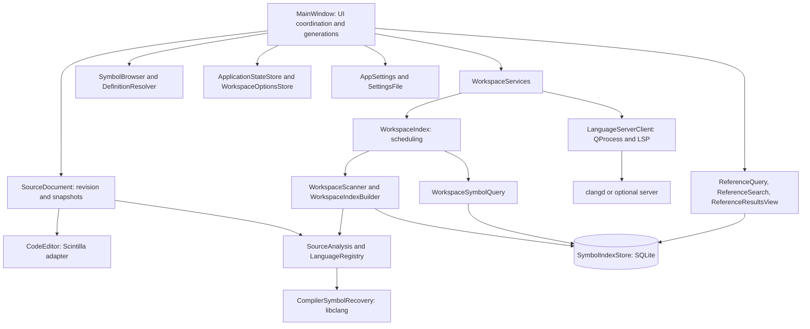
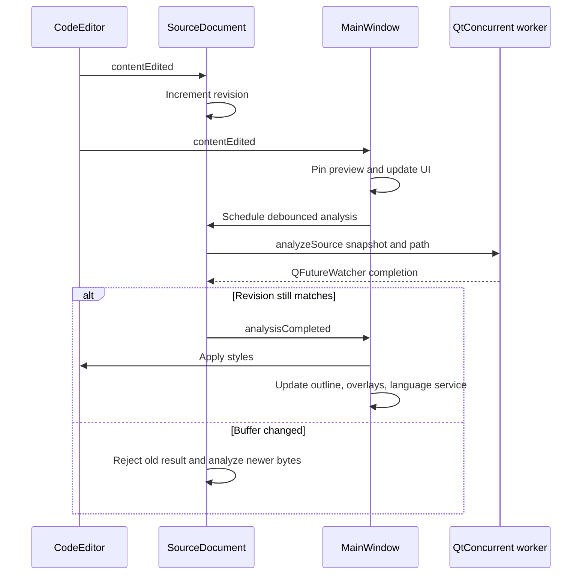
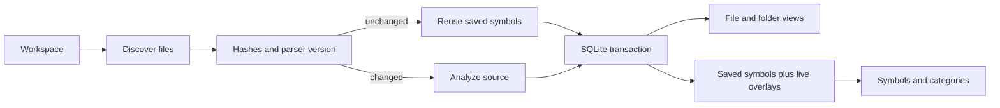
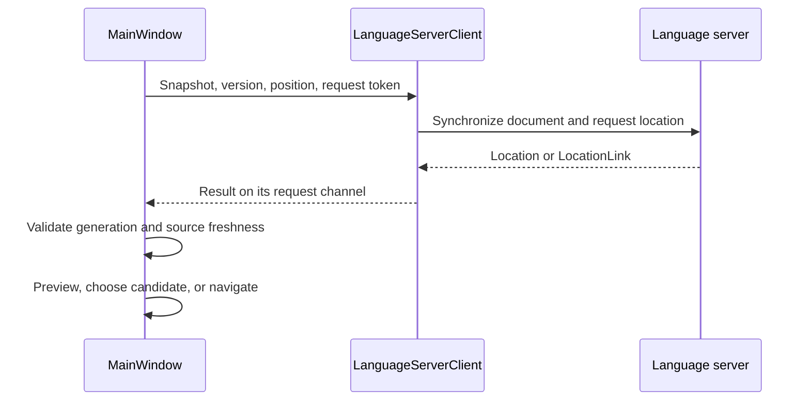

# CodeCairn developer guide

This is the single guide for learning and maintaining the codebase. Start with
[Getting started](#getting-started) if you are new to the project or Qt; use the
later sections as the implementation reference. The [README](../README.md) covers
setup and quick usage; the [user guide](USER_GUIDE.md) explains features and every
group of UI options. Project-wide coding-assistant conventions are in
[AGENTS.md](../AGENTS.md).

[Getting started](#getting-started) | [Qt concepts](#qt-concepts) |
[Architecture](#architecture-and-code-map) | [UI](#ui-and-interaction-model) |
[Data flows](#data-flows) | [Storage](#storage-and-settings) |
[Build system](#build-system) | [Testing](#testing-and-debugging) |
[Making changes](#making-changes)

## Getting started

### Build and explore

CodeCairn is a C++20 Qt Widgets application using upstream Scintilla's Qt wrapper. Follow the
[platform setup](../README.md#build-and-run) before configuring. On Windows, keep
the compiler, Qt, and libraries in the MSYS2 UCRT64 toolchain; do not mix UCRT64
and MINGW64 or reuse a build directory configured with another compiler.

Command examples use Bash/zsh, including MSYS2 UCRT64 on Windows.
Configure using the README's platform options, also adding
`-DCMAKE_EXPORT_COMPILE_COMMANDS=ON`, then run from the project directory:

```sh
cmake --build build --parallel
ctest --test-dir build --output-on-failure -R '^(configuration|interactions)$'
```

Use the default build or `--target deploy` for a runnable bundled Windows tree:
building only `--target codecairn` skips deployment. Keep the accompanying DLLs,
plugins, `qt.conf`, and Clang resource headers with the executable. Linux/macOS
commands and executable locations are in the README. For disconnected builds,
see [Offline builds](#offline-builds).

### A ten-minute UI tour

1. Open a folder through **Project > Open Folder** and wait for indexing.
2. Filter Project Files and select a file. Browse another file to observe reuse
   of a clean preview tab; Enter, double-click, or editing pins it.
3. Select an outline symbol, then click inside a different function in source.
   Notice the difference between navigating from the outline and the outline
   following the editor without moving its caret.
4. Open Project Symbols and try fragments such as `doc write`, a function-only
   query such as `open(`, and an RE2 expression such as `?^parse.*`.
5. Browse Folders and Symbol Categories. Inspect the context preview without
   activating the source file.
6. Lock context and move the caret; unlock it to resume tracking.
7. Run Lookup References using Text Occurrences first, which needs no server.
   Try result selection, source-link icons, Ctrl+L, and next/previous reference.
8. Try Replace all results, then explicitly close the results tab: closing it
   resets its searches, whereas quitting with it open preserves completed groups.
9. Type in a panel filter, browse its list, then press Escape or leave the panel.
10. Use Go Back and Go Forward to inspect editor navigation history.

For semantic browsing, enable compilation database export in the project being
browsed and select its build directory through
**Project > Compilation Database Directory**. This project's own build database
does not describe other workspaces.

### Suggested reading order

Follow one complete user interaction rather than reading the largest parser
implementation line by line.

| Pass | Read | Goal |
|---|---|---|
| 1 | [main.cpp](../src/main.cpp), [MainWindow.h](../src/MainWindow.h) | Startup and ownership |
| 2 | `buildUi()` in [MainWindowUi.cpp](../src/MainWindowUi.cpp) | Map visible controls to widgets |
| 3 | [CodeEditor.cpp](../src/CodeEditor.cpp), [SourceDocument.cpp](../src/SourceDocument.cpp) | Buffer events, revisions, snapshots, workers |
| 4 | [SourceAnalysis.h](../src/SourceAnalysis.h), [SourceTypes.h](../src/SourceTypes.h) | Styles, symbols, coordinates, and provenance |
| 5 | [MainWindowNavigation.cpp](../src/MainWindowNavigation.cpp) | Preview, activation, focus, and safe targets |
| 6 | [MainWindowReferences.cpp](../src/MainWindowReferences.cpp), [ReferenceTests.cpp](../tests/ReferenceTests.cpp) | Trace a complete asynchronous feature |
| 7 | [WorkspaceIndex.h](../src/WorkspaceIndex.h), [MainWindowWorkspace.cpp](../src/MainWindowWorkspace.cpp) | Saved symbols versus live overlays |
| 8 | Parser, compiler, and language-server implementations | Study internals as a change requires |

Before changing behavior, be able to answer: which widget starts it, who owns
the state, which signal connects it, what runs asynchronously, how stale work is
rejected, and which test proves the result?

## Qt concepts

### Application, widgets, and layouts

[main.cpp](../src/main.cpp) creates `QApplication`, sets application identity and
worker limits, parses arguments, constructs the window, opens startup paths,
and enters `app.exec()`. The event loop dispatches input, timers, painting,
process output, and worker completions. Blocking a handler with parsing or a
filesystem scan prevents other UI work.

`QMainWindow` supplies menus, toolbars, a central widget, and a status bar.
`QVBoxLayout` and `QGridLayout` arrange controls; `QSplitter` provides resizable
regions; `QTabWidget` owns pages. The UI is constructed in C++ in
[MainWindowUi.cpp](../src/MainWindowUi.cpp), not in a Designer `.ui` file.

### Signals, connections, and resources

A signal announces an event; a connected method or lambda handles it. Modern
typed connections do not require the receiver to be declared in a `slots:` block:

```cpp
connect(outlineFilter_, &QLineEdit::textChanged,
        this, &MainWindow::filterOutline);
```

The context object in a connection controls its lifetime. For example:

```cpp
connect(doc, &Document::analysisRejected, doc->editor,
        [this](const QString &error) {
            reportError(error);
            updateOutline();
            updateOpenSymbols();
        });
```

Qt disconnects this connection when its context is destroyed. Arbitrary raw
pointers captured by the lambda still need separate lifetime reasoning.
`Q_OBJECT` enables custom signals; CMake's AUTOMOC generates the meta-object code.
AUTORCC compiles [resources.qrc](../resources.qrc). Paths beginning `:/` refer to
embedded resources, not ordinary filesystem files.

`setObjectName("outline")` assigns a programmatic ID, not a visible label.
Tests use these IDs with `findChild`, and stylesheets can select them. Treat
widget/action IDs as contracts rather than cosmetic names.

### Ownership and useful types

| Type or pattern | Role |
|---|---|
| QObject parent | Parent destruction deletes its QObject children |
| `std::unique_ptr<SourceDocument>` | C++ ownership of document records |
| `QPointer<QWidget>` | Non-owning pointer cleared when the QObject is destroyed |
| `QByteArray` | UTF-8 source bytes, hashes, or style bytes |
| `QString` | UI text and paths, indexed in UTF-16 code units |
| `QVector<T>`, `QHash<K,V>` | Result collections and lookup tables |
| `QSignalBlocker` | Suppresses callbacks during programmatic view updates |
| `QFutureWatcher<T>` | Delivers asynchronous completion to the owning side |

The tab hierarchy owns editor widgets. SourceDocument owns its analysis/reload
watchers and debounce timer; MainWindow owns document records and coordinates
their widgets. Closing a source tab stops its work before deleting its editor.

A nested event loop does not freeze the rest of the application. Results menus
use parent-owned heap menus with `popup()` and deferred deletion, not a stack
menu parented to a view with `exec()`: closing that view could otherwise delete
the stack menu. Modal export/timestamp dialogs also revalidate page lifetime
before using widgets or applying changes.

## Architecture and code map



Three analysis technologies have distinct responsibilities:

| Technology | Used for | Does not establish |
|---|---|---|
| Tree-sitter | Styling, outlines, syntax-symbol extraction | Compiler-resolved types or overloads |
| libclang | Selective C/C++ recovery and inactive-region analysis | A continuously running language server |
| clangd | Compiler-aware C/C++ definitions and references | Readiness of the separate SQLite catalog |

A completed catalog rebuild does not imply that the server has indexed every
translation unit. A same-named syntax symbol is a candidate, not proof of identity.

### Code map

All `MainWindow*.cpp` files implement the **same class**, declared in
[MainWindow.h](../src/MainWindow.h). They split UI responsibilities; they are not
separate controllers.

| Area | Entry points |
|---|---|
| Startup and command-line paths | [main.cpp](../src/main.cpp) |
| Window, document UI, outline, context, open/save/close | [MainWindow.cpp](../src/MainWindow.cpp) |
| Widget hierarchy, actions, menus, toolbars, enablement | [MainWindowUi.cpp](../src/MainWindowUi.cpp) |
| Workspace services, browser integration, definition previews | [MainWindowWorkspace.cpp](../src/MainWindowWorkspace.cpp) |
| Preview tabs, focus, asynchronous navigation reads, history | [MainWindowNavigation.cpp](../src/MainWindowNavigation.cpp) |
| Hover links and explicit definition jumps | [MainWindowLinks.cpp](../src/MainWindowLinks.cpp) |
| Search dialog, orchestration, replacement, results lifecycle | [MainWindowReferences.cpp](../src/MainWindowReferences.cpp) |
| Preferences and per-panel options | [MainWindowSettings.cpp](../src/MainWindowSettings.cpp), [MainWindowPanels.cpp](../src/MainWindowPanels.cpp) |
| Document revisions, snapshots, analysis, external reload | [SourceDocument.h](../src/SourceDocument.h), [SourceDocument.cpp](../src/SourceDocument.cpp) |
| Text, selections, undo, styles, source-link margin | [CodeEditor.h](../src/CodeEditor.h), [CodeEditor.cpp](../src/CodeEditor.cpp) |
| Parsing, language selection, compiler recovery | [SourceAnalysis.cpp](../src/SourceAnalysis.cpp), [LanguageRegistry.cpp](../src/LanguageRegistry.cpp), [CompilerSymbolRecovery.cpp](../src/CompilerSymbolRecovery.cpp) |
| Index/service ownership | [WorkspaceServices.cpp](../src/WorkspaceServices.cpp) |
| Index scheduling, watchers, cancellation | [WorkspaceIndex.cpp](../src/WorkspaceIndex.cpp) |
| Discovery, transactions, queries | [WorkspaceScanner.cpp](../src/WorkspaceScanner.cpp), [WorkspaceIndexBuilder.cpp](../src/WorkspaceIndexBuilder.cpp), [WorkspaceSymbolQuery.cpp](../src/WorkspaceSymbolQuery.cpp) |
| SQLite and path identity | [SymbolIndexStore.cpp](../src/SymbolIndexStore.cpp), [WorkspacePaths.cpp](../src/WorkspacePaths.cpp) |
| Browser rows and syntax fallback | [SymbolBrowser.cpp](../src/SymbolBrowser.cpp), [DefinitionResolver.cpp](../src/DefinitionResolver.cpp) |
| LSP, compilation database, coordinate conversion | [LanguageServerClient.cpp](../src/LanguageServerClient.cpp), [CompilationDatabase.cpp](../src/CompilationDatabase.cpp), [SourceCoordinates.cpp](../src/SourceCoordinates.cpp) |
| Typed search options, matching, semantic result resolution | [SearchOptions.h](../src/SearchOptions.h), [ReferenceQuery.cpp](../src/ReferenceQuery.cpp), [ReferenceSearch.cpp](../src/ReferenceSearch.cpp) |
| Candidate postings, history validation/export, text caret | [ReferenceCandidateIndex.cpp](../src/ReferenceCandidateIndex.cpp), [ReferenceHistory.cpp](../src/ReferenceHistory.cpp), [ReferenceResultsView.cpp](../src/ReferenceResultsView.cpp) |
| Preferences, window/session state, workspace options | [AppSettings.cpp](../src/AppSettings.cpp), [ApplicationStateStore.cpp](../src/ApplicationStateStore.cpp), [WorkspaceOptionsStore.cpp](../src/WorkspaceOptionsStore.cpp) |
| File safety, shared limits, appearance | [FileIO.cpp](../src/FileIO.cpp), [RuntimeLimits.h](../src/RuntimeLimits.h), [UiAppearance.cpp](../src/UiAppearance.cpp) |

MainWindow aliases `SourceDocument` as `Document`. Its important state is:

```text
editor                    live Scintilla buffer
path / hasUtf8Bom          disk identity and BOM information
savedBytes / saved hash    saved-content identity
revision                  version of current live text
analyzedRevision          version described by accepted analysis
analysis                  styles, symbols, diagnostics
private timers/watchers   debounce, analysis, reload lifecycle
isPreview                 whether the editor tab can be reused
outline keys / scroll     remembered selection and expansion
snapshotBytes() / hash    revision-cached asynchronous input
```

The editor buffer is authoritative while editing. A disk file, saved index row,
or context snapshot is not automatically the same version of that text.

### Responsibility and naming rules

- Keep UI focus, selection, and request generations in MainWindow; document
  lifecycle and accepted analysis in SourceDocument.
- [SourceTypes.h](../src/SourceTypes.h) and [IndexTypes.h](../src/IndexTypes.h) hold
  shared result data; [SourceCoordinates.h](../src/SourceCoordinates.h) defines LSP
  locations and explicit coordinate conversion.
- Keep language identity typed as `LanguageId`.
- Use purpose-specific names and named item roles such as `SymbolItemRole`.
  Preserve symbol/category/provider strings, widget IDs, JSON keys, and parser
  identities unless a deliberate contract change requires otherwise.
- Reuse existing facades and helpers; do not add a generic plugin/controller
  framework to split a single responsibility.

## UI and interaction model

The [fixture screenshot](images/codecairn-overview.png) shows the regions:

```text
QMainWindow
+------------------+------------------------+-------------------------+
| Menu bar, main toolbar, separate documentBar_ tab strip             |
+------------------+------------------------+-------------------------+
| Symbol Window    | documentsTabs_         | Context preview         |
| title + filter   | CodeEditor pages       | title + chooser         |
| outline tree     | or Search Results      | read-only CodeEditor    |
| outline toolbar  |                        | context toolbar         |
|                  |                        +-------------------------+
|                  |                        | Project Files / Symbols |
|                  |                        | Folders / Categories    |
+------------------+------------------------+-------------------------+
| Status bar                                                         |
+--------------------------------------------------------------------+
```

`mainSplitter_` divides the horizontal regions; `rightSplitter_` divides context
from the browser. A separate `QTabBar` supplies the visible document strip.
The built-in `QTabWidget` tab bar is hidden, and selected indices are connected
both ways. Search Results is a page, **not a source document**; `activeEditor()`
can legitimately return null.

### Outline and temporary filters

`updateOutline()` maps analysis parent indices to `QTreeWidgetItem` children.
Rows store symbol index, kind, line, and a stable key. Expansion, selection,
and scroll state survive rebuilds; blockers prevent partial construction from
triggering navigation.

`syncOutlineToEditor()` selects the innermost visible symbol for the editor
selection, expands parents, and reveals it without moving the caret, taking
focus, or recording a jump. It waits for accepted analysis when necessary.
Passive reanalysis preserves remembered outline state when there is no new
selection target; explicit editor selection can clear an outside-symbol match.

The outline, Project Files, and Project Symbols filters are temporary. Typing
in a list routes text to its filter. Moving between the box and list preserves
the query; Escape, confirmation, leaving the panel, and history navigation clear
it. Confirmation means Enter or double-click, not a single-click browse.
Project-symbol confirmation waits for the latest filtered query; clearing the
filter cancels queued navigation. Preserve the chosen row when restoring the
full list.

When results are active, the outline instead lists searched queries. Selecting
one reveals its matches in context; Delete removes that query's result groups.

### Browsers, actions, and context

| Region | Data and behavior |
|---|---|
| Project Files | `populateFiles()` builds path/size rows and folder hierarchy |
| Project Symbols | `updateOpenSymbols()` queries; `displaySymbols()` delegates to SymbolBrowser |
| Symbol Categories | Category order comes from SourceAnalysis; SymbolBrowser renders all children |
| Context | `updateContext()` chooses targets; `showContext()` loads and selects source |
| Search Results | ReferenceResultsView combines structured rows with a read-only QTextCursor |

The browsers use `QTreeWidget`, not a custom abstract item model.
NavigationTree distinguishes real keyboard selection from model refreshes.
Preview navigation retains panel focus; activation focuses/pins the editor.

`buildUi()` creates one `QAction` per operation and reuses it in menus/toolbars.
Wire creation, behavior, shortcuts, enablement, and focus together.
UiAppearance centralizes fonts, stylesheets, tree appearance, and original icons.
Panel options and configuration propagation belong in the existing window files.
The standalone document tab bar is left-aligned in its layout rather than
stretching across it, so native macOS tab centering cannot offset the first tab.

Context is a read-only CodeEditor. It can follow selected identifiers, show an
enclosing function, or be disabled. Semantic ambiguity can require a chooser.
Link activation must finish any mouse gesture forwarded to Scintilla before
navigation changes focus. Ctrl-click consumes both press and release; plain
context-link clicks forward both, preserving normal drag selection.
**Pinning a document** prevents preview-tab reuse; **locking context** prevents
automatic preview replacement. Editor jump history and context snapshot history
are separate and bounded.

## Data flows

### Opening a workspace

MainWindow normalizes the root, validates/initializes per-user storage, prepares
the normalized compilation database, starts indexing/services, and restores the
session. Switching roots invalidates obsolete work but does not automatically
close every existing editor.

Startup restores the last available workspace unless explicit paths override it.
Opening a first-time folder does not automatically open an example file.
Tests redirect/disable persistence and use isolated application identities.

### Editing and analysis



The default parse debounce is 180 ms in
[default-settings.json](../config/default-settings.json). Workers receive copied
snapshots/path data, never widget pointers. Revision checks are required:
same-length text replacement can invalidate analysis without changing byte count.
`applyStyles()` also checks array length, but that is not the freshness test.

`analyzeSource()` returns:

- One style byte per source byte.
- Symbols with full/name ranges, parents, kinds, categories, declaration/
  definition information, and provider provenance.
- Support, syntax-error, and recovery diagnostics.

LanguageRegistry selects grammars; ambiguous headers are scored with both
C-family grammars. Each request has a private `AnalysisContext`. The analysis
stages include `extractSyntax()`, `qualifyAndStyleSymbols()`, `styleBindings()`,
and `recoverCompilerSymbolsIfNeeded()` in intentional order. Preserve traversal,
parent, binding, and enrichment semantics when refactoring.

Tree-sitter trees are rebuilt per snapshot; incremental tree reuse is not
implemented. Compiler recovery uses libclang with filtered analysis arguments,
not a compiler-driver subprocess. Generated declarations retain invocation
ranges, and syntax/recovery limitations remain visible.

### Coordinate contracts

```text
Scintilla / Tree-sitter / source symbols: UTF-8 byte offsets
QString / results QTextCursor:          UTF-16 code units
LSP:                                   zero-based line + UTF-16 character
Displayed line labels:                 normally one-based
Ranges:                                end-exclusive [start, end)
```

An accented character can use two UTF-8 bytes; an emoji can use two UTF-16 code
units. Neither visible-character counts nor QString indexes are source byte
offsets. Use `lspPosition()` and `sourceByteOffset()` in
[SourceCoordinates.cpp](../src/SourceCoordinates.cpp); invalid boundaries are errors.
Styling must preserve bytes, BOM, selections, undo, and dirty state.

### Indexing and symbol queries



WorkspaceIndex owns scheduling, cancellation, and notifications. Discovery,
transactional construction, storage, and queries have separate implementation
files listed in the code map. Each worker owns its SQLite connection; WAL allows
concurrent readers, and failed/cancelled writes roll back.

Indexing has a dedicated single low-priority worker; global work is capped at
two. Overlapping refreshes queue one follow-up pass rather than cancelling the
active transaction. Notifications debounce for 700 ms; the six-hour poll checks
missed changes. `behavior.workspaceRefreshMinutes` accepts 1-35791 minutes and
applies at startup/reload. Native watches are capped at 2,048 paths.

Directory notifications compare worker-side snapshots, exclude metadata/build
folders, and ignore directory timestamps. File notifications and polls still
verify content when size/mtime are unchanged. Unchanged automatic checks stay
quiet; manual refreshes and new warnings remain visible. Cancel pauses automatic
refresh until resumed. Cancellation is checked between files, not inside a parse.

Live overlays replace disk symbols for open files but are not persisted as
saved contents. Clean external changes can reload; dirty buffers are preserved.
Internal lookup callers use bounded pages; Project Symbols requests all matches
and has no hidden row cap. SymbolBrowser preserves keys, expansion, and scroll.

C/C++ extraction includes both forward tags and typedef aliases, without
inventing declarations for ordinary tag uses. Macro-shaped definitions can
trigger compiler recovery even when syntax parsing succeeds. Recovered
definitions replace misidentified invocation arguments instead of adding false
function names. Bump ParserVersion when saved extraction meaning changes.

### Navigation and definition lookup

`navigateTo()` and `commitNavigation()` form the shared navigation path:

1. Capture origin/focus and advance the navigation generation.
2. Reuse an open document or read the destination asynchronously.
3. Reject obsolete work and validate expected source hashes/ranges.
4. Reuse a clean preview tab or create a document.
5. Select the target and record editor history.
6. Retain panel focus for browsing or focus/pin on activation.

Editing a preview pins it. A dirty editor is never silently reused.
[NavigationHistory.h](../src/NavigationHistory.h) defines locations with byte or
LSP ranges, expected hashes, scroll state, and reference-line selection.

Automatic context follows `updateContext()` -> `resolveDefinition()` ->
`handleDefinitions()`. Hover/jump follows `lookupLink()` -> `handleLocations()`
-> `navigateDefinition()`. Both routes use LanguageServerClient:



The client owns QProcess, JSON-RPC framing, IDs, timeouts, full-text document
synchronization, cancellation, and independent channels. clangd lookup prefers
the bundled executable where applicable, then PATH and the configure-time
installation. Project/user configuration and query-driver execution are disabled.

A failed definition lookup can offer explicitly unverified syntax candidates;
ambiguous candidates need a chooser. An enclosing declaration is not a fake
definition resolver. Hover cannot move the caret or revive a stale link.
Context snapshots must match live source before server lookup.

### Reference searches and results

Read [MainWindowReferences.cpp](../src/MainWindowReferences.cpp) as a complete
feature walkthrough:

1. `lookupReferences()` captures the active/context/browser symbol and shows
   the dialog. Query, scope, file types, matching options, and output choices
   are validated. Combo boxes carry method enum data, not behavior tied to
   display order.
2. Starting a search cancels the old request, captures overlays and scoped paths,
   creates a shared cancellation flag, and advances `referenceToken_`.
3. Smart reference matching sends LSP `textDocument/references`; returned ranges
   are validated and deduplicated by canonical path/range through
   `resolveSemanticReferences()`. Provider failure never silently becomes text.
4. Other modes use `searchReferences()` in ReferenceQuery: literal, regex,
   keyword-expression, or whole-identifier matching. RE2 validates expressions;
   keyword parsing supports Boolean/grouped terms, proximity, variations, and
   fragments. Syntax styles implement comment/string filters.
5. Exact identifier searches can use ReferenceCandidateIndex postings.
   Proven-negative files need fresh hashes before exclusion; dirty overlays
   remain candidates. Unicode queries conservatively bypass acceleration.
   This does not establish semantic identity or guarantee lower disk I/O.
6. Inactive C/C++ filtering uses libclang, compilation flags, and captured
   headers. Macro-dependent conditions need an exact compilation command;
   otherwise only unambiguous literal conditions can be filtered. Unsupported
   or uncertain regions are retained with warnings.
7. `displayReferenceHits()` updates structured groups and source links;
   ReferenceResultsView supplies a read-only QTextDocument/QTextCursor for
   caret movement, text selection/copy, and hover feedback.

Tokens and cancellation flags solve different problems. Cooperative workers
can still finish late; only the current token/page may accept a completion.
Both text and semantic results carry source snapshot identities.
The legacy `findTextOccurrences()` helper also remains used by focused
tests/benchmarks; it is not the complete UI search dispatcher.

Results have 10,000 matches per page, with explicit continuation. Previously
read/pruned sources are hash-checked between pages; changed buffers require a
new search rather than silently shifting offsets. History is bounded to 1,000
groups and 100,000 rows. Selecting a row previews its full referenced line;
link icons, Enter, and Ctrl+L activate navigation. The source-margin link returns
to the result. Next/previous reference also work from source.

Source/result icons share logical sizing; margin RGBA images must not use a
high-DPI pixmap's physical size as their logical dimensions. Red hover outlines
and the text caret are presentation only. Edits outside a linked range adjust
it; edits within the range mark it stale. External changes require hash checks.

**Result lifecycle is intentional:**

- Unchecked Replace all results appends groups.
- Checked replacement stages all pages, then saves and commits together.
  Failure, cancellation, stale source, limits, or a save error retains the old
  groups. A completed zero-match query is a valid replacement.
- Cancel Search invalidates work but retains completed groups.
- Explicitly closing the tab cancels work, clears completed/staged groups and
  link markers, and saves the empty history. The next search starts fresh.
- Quitting with the tab still open saves completed groups for workspace restore.
- Timestamp-touching starts off and requires confirmation; cancellation/page
  lifetime is rechecked before any modification.

Keep result pages out of source-document counts and source save/undo paths.
Do not lose groups merely because a newly created view has not yet received
a successful search; creation must reflect the current model. Shutdown stops
timers/services, invalidates work, disconnects callbacks, and joins owned futures
before document and Qt state can be destroyed.

## Storage and settings

### Source-file safety

[FileIO.cpp](../src/FileIO.cpp) accepts validated UTF-8, strips/remembers an optional
BOM, rejects binary/invalid encodings, and enforces the 4 MiB source limit.
CodeEditor detects CRLF on load. Saving uses QSaveFile atomic replacement and
checks external changes. Appearance changes must not rewrite source, alter undo,
clear dirty state, or replace dirty buffers in background.

### Persistent syntax index

SQLite schema version is **2**. Version 1 migrates transactionally; unsupported
newer versions are rejected. The reference tables are created when absent and
carry a separate per-file posting version.
Candidate readers check the schema version inside their read transaction. Before
the initial schema or a legacy migration commits, they retain all source files
for a full search; a version-2 database with missing tables remains an error.

| Table | Purpose / fields |
|---|---|
| `files` | `path`, `hash`, `size`, `mtime`, `state`, `error`, `parser` |
| `symbols` | Names, kind/category, qualified/signature, definition flag, byte/name ranges, line, generated/provider |
| `reference_occurrence_files` | Indexed path/hash, posting version, ASCII-only flag |
| `reference_occurrences` | Per-file identifier and folded-identifier postings |

Deletion cascades through file-owned rows. Hashes describe decoded UTF-8 bytes
with the BOM removed. Paths use canonical/absolute identity; metadata/database
symlinks are rejected, and failures never redirect to another store.
ParserVersion is separate from schema/posting versions. Changes require tested
invalidation or migration, not silent database deletion.

### Separate JSON configuration and state

| Store | Owns |
|---|---|
| Per-user `settings.json` or `--config` profile | Appearance, panel/search options, initial layout, debounce and refresh intervals |
| `state.json` | Window geometry, splitters, browser tab, last workspace |
| `workspaces/<workspace-hash>/session.json` | Ordered open files, active path, selections/scroll, completed search groups |
| `workspaces/<workspace-hash>/workspace.json` | Schema, canonical root, compilation directory, exclusions |
| `workspaces/<workspace-hash>/index.sqlite3` | Generated file/symbol catalog and reference postings |
| `workspaces/<workspace-hash>/clangd/` | Normalized compilation database and semantic caches |

`--config` changes only the preferences path. Runtime state uses Qt
StateLocation on Qt 6.7+, or `state` under AppLocalDataLocation on Qt 6.5/6.6.
It lives outside source folders and custom profiles; see the
[user guide location table](USER_GUIDE.md#per-user-locations). The organization name is
empty, so the standard path has one CodeCairn component.

Workspace directory names are SHA-256 hashes of canonical-root UTF-8 paths.
Missing file paths resolve through their nearest existing canonical ancestor,
so deleted files and new buffers retain workspace membership through directory
aliases. Reference posting lookups and LSP request URIs use the same canonical
identity as indexing and document synchronization.
Generated compilation databases canonicalize file and working-directory fields
without rewriting compiler arguments. Result-page freshness checks reuse each
document's revision-cached snapshot hash rather than hashing once per result.
WorkspacePaths owns the locations; WorkspaceOptionsStore initializes versioned
options before indexing/services. The stored root must match the requested
workspace. An empty compilation directory enables discovery. Edit through the
UI or close the app before manual changes; the generated normalized compilation
database is not the persistent configuration source.

[default-settings.json](../config/default-settings.json) is the single default
profile, embedded through [resources.qrc](../resources.qrc). Test resources belong
only to test targets. `parseSettings()` merges partial overrides with defaults
and rejects unknown keys, wrong types, versions, invalid RGB/ranges, and input
over 256 KiB. Obtain typed settings by parsing or `defaultAppSettings()`, not
zero-initialized structures. Existing explicit user values override new defaults.

Source `fontSizePt` values use a 96-DPI reference, preserving Windows sizing
across platforms and existing profiles. `UiAppearance::nativeSourcePointSize()`
converts to native Qt points using the named `SourceReferenceDpi` baseline and
the current widget's `logicalDpiY()` for both the default style and
syntax styles, after context/syntax scaling. The default 8.25 pt therefore renders
at 11 logical pixels, including on macOS (72 logical DPI). Do not multiply by
device-pixel ratio: Qt/Scintilla already handle physical display scaling.
CodeEditor reconnects its `QScreen::logicalDotsPerInchChanged` subscription when
shown or moved to another screen, disconnecting the old subscription. Both
screen transitions and live logical-DPI changes reapply typography without
editing the buffer. Stored values, source appearance controls, and serialization
remain in reference points, not native points.

`applyConfiguration()` updates widgets/source/context without editing documents.
Block signals to avoid recursive control changes. No settings-file I/O belongs
in paint or keystroke paths.

### State schema, write lifecycle and concurrent instances

Window and session state use integer `schemaVersion: 1`:

- `state.json` contains `lastWorkspace` and `window`: `geometry`, `mainSplitter`,
  `rightSplitter`, and `browserTab` (0-3). Qt layout bytes are canonical Base64.
- Session JSON contains `workspaceRoot`, `files`, `activeFile`, and optional
  `references`. File entries have absolute in-workspace paths, nonnegative
  end-exclusive `start`/`end`, and `firstLine`. Duplicate files, reversed
  selections, or an active file absent from the list are invalid.
- Search groups contain output choices, query/title, and validated linked hits.
  They are saved excerpts/ranges, not backups of unsaved source buffers.

Unknown fields/versions, invalid types/Base64/ranges/root identities are errors.
Window state is bounded to 4 MiB; workspace sessions to 32 MiB. Invalid Qt layout
bytes are reported and disable writes to damaged state. Missing state files
mean a new session; reads alone do not create them.

Writes occur at workspace/window boundaries, explicit results-tab closure,
query deletion, and successful result replacement, not each caret movement.
Restore clamps source selections, skips missing files with warnings, and pins
restored tabs. Explicit startup files reuse restored documents. Close Project
clears the startup hint but retains the workspace session for an explicit reopen.

SettingsFile/ApplicationStateStore first load a file, then take its sibling lock,
verify existence/content fingerprint, and commit through QSaveFile. Cooperating
stale writers are refused. State and session files have independent locks, not
one cross-file transaction; different workspaces have independent session files.
Workspace options use `workspace.json.lock`; index writers use `index.lock`.

Failures report affected paths and preserve invalid/external data. On close,
the user can cancel or explicitly discard unsaved state. Restart after a stale
writer conflict. For damaged state, close the app, back up and repair/remove
only the affected JSON file. Source files, preferences, and indexes need not
be removed. There is no legacy import, fallback store, or automatic cleanup.

## Build system

### Configure, build, test, install

[CMakeLists.txt](../CMakeLists.txt) builds `codecairn_core`, reused by the application,
behavior/parity tests, and benchmarks. Application C++ uses C++20; Scintilla is
built separately with C++17. Generated grammars compile directly; ordinary builds
do not run a Tree-sitter generator or qmake.

| File | Responsibility |
|---|---|
| [CMakeLists.txt](../CMakeLists.txt) | Application/core targets and install rules |
| [Dependencies.cmake](../cmake/Dependencies.cmake) | System/source providers, ABI probe, Scintilla |
| [LanguageGrammars.cmake](../cmake/LanguageGrammars.cmake) | Grammar pins, parser targets, licenses |
| [Deployment.cmake](../packaging/Deployment.cmake) | Platform deployment registration |
| [CPack.cmake](../packaging/CPack.cmake) | Standalone generators, names, checksums, metadata hook |
| [tests/CMakeLists.txt](../tests/CMakeLists.txt) | QtTest setup and CTest registration |

Configuration generates build rules; building compiles/links; tests exercise
them; installation stages a distribution. These are separate operations.
Keep generated files in a build directory and follow the README's platform
compiler/prefix requirements.

For local macOS development with dependencies built for a newer OS, configure
with a matching target, for example `-DCMAKE_OSX_DEPLOYMENT_TARGET=27.0`.
This changes only the build cache, not the default macOS 26 release target.
Release/CI dependencies must themselves support macOS 26.

The shared `.vscode/settings.json` enables compilation database export and the
Microsoft C/C++ extension's CMake Tools configuration provider. After installing
dependencies, select the platform compiler kit and configure; CMake Tools supplies
the discovered header paths to IntelliSense. Keep personal overrides in VS Code
user settings for kit mode, or Git-ignored `CMakeUserPresets.json` for preset mode.
Set `cmake.useCMakePresets` to `always` when using only user presets.

### Dependency resolution

| Input | Provider |
|---|---|
| Qt, SQLite, RE2 | Installed development packages through `find_package`; RE2 also accepts pkg-config |
| Tree-sitter runtime, libclang | Installed headers/libraries through `find_path` / `find_library` |
| clangd | Optional executable discovery |
| Scintilla and grammars | Hash-pinned FetchContent archives or local overrides |

Package managers install system dependencies; CMake finds them. Native macOS
builds discover Homebrew through `brew --prefix`, including its keg-only LLVM
and SQLite prefixes. Native MinGW builds search the selected compiler's prefix;
Linux builds also query `llvm-config --prefix` when available. These discovered
prefixes are appended after explicit `CMAKE_PREFIX_PATH` entries, and explicit
dependency cache variables remain authoritative. Cross-compilation skips these
host-package hints; provide the target toolchain and dependency paths instead.
No packages are installed during configuration. Use
`CMAKE_PREFIX_PATH` for nonstandard prefixes or explicit
`LIBCLANG_INCLUDE_DIR` / `LIBCLANG_LIBRARY`. The Tree-sitter ABI probe checks
support for grammar ABI 14 and 15; the CLI alone is insufficient.

Existing caches retain previously selected libraries. To rediscover them, use a
fresh build directory or clear the affected dependency cache entries; adding a
prefix does not replace a cached system SQLite or LLVM selection.

`codecairn_source()` prefers a local override, otherwise a pinned archive when
downloads are allowed. `codecairn_grammar()` registers parser/scanner targets and
licenses. TypeScript/TSX share a repository. Downloads normally live in `_deps`;
do not patch disposable dependency trees. System packages are not locked by
archive hashes. Change source pins deliberately and validate upgrades.

### Offline builds

Installed development packages are still required. Supply all source overrides
when downloads are disabled. This example uses Bash/zsh syntax, including the
MSYS2 UCRT64 shell on Windows. Set `vendor` to your dependency directory and add
the platform-specific compiler/prefix options from the
[README](../README.md#build-and-run).

```sh
vendor="$HOME/vendor"
cmake -S . -B build -G Ninja -DCMAKE_BUILD_TYPE=Debug \
    -DCODECAIRN_ALLOW_DOWNLOADS=OFF \
    "-DCODECAIRN_SCINTILLA_SOURCE_DIR=$vendor/scintilla" \
    "-DCODECAIRN_C_GRAMMAR_SOURCE_DIR=$vendor/tree-sitter-c" \
    "-DCODECAIRN_CPP_GRAMMAR_SOURCE_DIR=$vendor/tree-sitter-cpp" \
    "-DCODECAIRN_PYTHON_GRAMMAR_SOURCE_DIR=$vendor/tree-sitter-python" \
    "-DCODECAIRN_BASH_GRAMMAR_SOURCE_DIR=$vendor/tree-sitter-bash" \
    "-DCODECAIRN_JAVASCRIPT_GRAMMAR_SOURCE_DIR=$vendor/tree-sitter-javascript" \
    "-DCODECAIRN_TYPESCRIPT_GRAMMAR_SOURCE_DIR=$vendor/tree-sitter-typescript" \
    "-DCODECAIRN_GO_GRAMMAR_SOURCE_DIR=$vendor/tree-sitter-go" \
    "-DCODECAIRN_RUST_GRAMMAR_SOURCE_DIR=$vendor/tree-sitter-rust" \
    "-DCODECAIRN_JSON_GRAMMAR_SOURCE_DIR=$vendor/tree-sitter-json" \
    "-DCODECAIRN_YAML_GRAMMAR_SOURCE_DIR=$vendor/tree-sitter-yaml" \
    "-DCODECAIRN_CMAKE_GRAMMAR_SOURCE_DIR=$vendor/tree-sitter-cmake"
cmake --build build --parallel
```

Inputs can be unpacked archives,
vendored trees, or pinned submodules; the project does not initialize submodules.
Scintilla needs its upstream Qt wrapper; grammar roots need generated parsers and
licenses. TypeScript's root supplies `typescript` and `tsx`.

Inputs are layout-checked, not hash-verified or automatically updated. Keep
durable overrides outside disposable builds. To resume downloads, enable
CODECAIRN_ALLOW_DOWNLOADS and clear overrides.

### Release builds

Standalone releases target Windows 11 x64, macOS 26+ ARM64, and Ubuntu 24.04+
x64 Linux. Standalone and Homebrew/Arch/MSYS2 package validation is manual.
Use the [release guide](RELEASING.md) for CPack packages, native package recipes,
the `cairn` launcher contract, CI, and publication gates. The source
archive includes hash-pinned source dependencies for offline package builds;
its shared pin manifest is [SourceArchives.cmake](../cmake/SourceArchives.cmake).
CodeCairn's own code is MIT licensed; dependency terms remain separate.

Use a separate directory and the README's platform-specific compiler/prefix options.
This example stages a development installation, not a release package:

```sh
cmake -S . -B build/release -G Ninja \
    -DCMAKE_BUILD_TYPE=Release \
    -DCMAKE_EXPORT_COMPILE_COMMANDS=ON \
    -DBUILD_TESTING=OFF
cmake --build build/release --parallel
cmake --install build/release --prefix "$PWD/build/release-package"
```

Add compiler/prefix settings as needed. BUILD_TESTING=OFF excludes tests/Qt Test,
not package creation or error reporting.

### Deployment

CODECAIRN_BUNDLE_RUNTIME defaults ON on every platform. It controls deployment,
not installation or dependency acquisition. Use a fresh build directory for OFF.

| Bundled platform | Default build | Installation |
|---|---|---|
| Windows | `deploy` gathers runtime beside executables | Reuses deployment for the installed copy |
| macOS | Builds the app bundle | macdeployqt gathers GUI, launcher, and clangd dependencies |
| Linux | Builds the executable | Qt deployment API, bundled clangd/resources and relative library search |

[DeployWindows.cmake](../packaging/DeployWindows.cmake) runs windeployqt, copies optional
clangd/resource headers, scans transitive executable/plugin dependencies with
objdump, copies non-system DLLs, and writes qt.conf. Unresolved dependencies are
errors; deployed/toolchain conflicts prefer the active toolchain prefix.

Windows executables/DLLs live in `build/bin`, with Clang headers in sibling
`build/lib/clang`. Multi-config executables use `build/bin/<config>` and resources
`build/bin/lib/clang`, still inside the build tree. Installed resource paths are
`<prefix>/lib/clang` on Windows/Linux and
`codecairn.app/Contents/lib/clang` on macOS. Linux/macOS development
builds use configured toolchain headers. No deployment writes above the build.

Installation is explicit; destinations remain prefix-relative for `--prefix`
and DESTDIR. [InstallWindows.cmake.in](../packaging/InstallWindows.cmake.in) supplies the
install adapter. There is no automated build-tree or installed-package runtime
validation; check deployed dependencies and native startup manually.

Building only codecairn bypasses deploy. Close running Windows applications
before replacing binaries. macOS and Linux bundled installation also deploy
clangd when found. Release builds require clangd.
The final macOS install hook applies ad-hoc signatures after library rewriting
and package metadata/license installation;
Developer ID signing, notarization, cross-distribution Linux certification, and native
certification remain separate release work.

Linux bundling requires Qt 6.7+ and patchelf. It includes non-system dependency
closure and Qt plugins, excluding the host loader, glibc and graphics-driver
libraries; binaries/plugins use package-relative RPATHs. Ubuntu 24.04 release CI
uses Qt 6.8.3 and privately builds pinned Tree-sitter with
`cmake/PrepareLinuxDependencies.cmake`. Linux release metadata collects dependency
inventory and Ubuntu copyright/common-license files plus prepared Qt/Tree-sitter
notices. Unidentified runtime owners or missing notices are release errors.

macOS distribution has two options: bundled standalone app DMG and managed
source-only Homebrew formula. There is no cask or CodeCairn bottle generation.
Homebrew recipe generation uses `PrepareRecipes.cmake`, recording the source
archive URL, version and hash. The formula lives in
`homebrew/Formula/codecairn.rb`. The formula resolves real dependency prefixes, uses
declared CMake/Ninja tools, and runs tests offscreen. Its `post_install` hook
ad-hoc signs nested code and the managed app after Homebrew's linkage/cleanup
fixups; installed signature and startup checks are manual.
`PrepareLocalTap.cmake` reuses that generator, stores immutable release archives
under `<LOCAL_ROOT>/artifacts/codecairn`, and updates only `tap/Formula/codecairn.rb`
in the generic `local/releases` tap. It protects modified formulas and different
same-name archives, preserves other packages, and never invokes Homebrew.
`COMMIT_TAP=ON` explicitly permits initializing/committing the generated tap;
it never commits the source checkout or unrelated tap files.
Homebrew compiles in its temporary build area, installs to the Cellar, and links
`cairn` through its bin directory; it does not build inside the project checkout.
Recipe generation does not install or validate upgrade behavior.

All packaging scripts/templates live in [packaging](../packaging). CMake owns
installation and deployment; CPack owns standalone ZIP/DMG/TAR generation and checksums.
The main project disables generic CPack source generation. Instead,
`PrepareSource.cmake` stages Git-scoped files and verified pinned source dependencies,
then invokes a source-only CPack project. Its archive has one `codecairn-<version>`
root and can configure/build with `CODECAIRN_ALLOW_DOWNLOADS=OFF`.

Release bundled installs record source revision and dirty status without enforcing
clean provenance, record the
compiler and dependency inventory, and include runtime license notices.
macOS standalone installation keeps `cairn` inside the app only; managed installs
also expose it through the prefix's bin directory.
Packaging-script tests and runtime-verification scripts are not registered or
maintained. Assembly copies expected assets and generates checksum files without
checking incoming checksums, recipe consistency or source provenance.
Standalone drafts contain three native
standalone formats, sources and recipes, with no managed packages or `.SRCINFO`.

The [build workflow](../.github/workflows/codecairn-build.yml) owns dependency
installation, functional tests and standalone packaging. ZIP/DMG/TAR installation,
runtime, signature, checksum and provenance verification is entirely manual.
The [release workflow](../.github/workflows/codecairn-release.yml)
validates the version tag, builds an immutable revision through the reusable
workflow, assembles assets, rechecks the tag, and creates a draft release.
Only the publication job has repository write permission.

There is no managed-package validation workflow. Build and install recipes
manually before distributing them. The
[performance workflow](../.github/workflows/codecairn-performance.yml) runs the
benchmark label separately. `CODECAIRN_BUILD_BENCHMARKS` defaults ON for local
testing; regular build CI and native package recipes set it OFF. Disabling it
does not exclude any functional tests.

Build directories are not automatically pruned. Retain matching binaries/symbols,
revision, and diagnostics when investigating failures. Scripts remove only their
own staging directory after success and retain failed staging; CPack owns its
package staging. CI uploads failure logs and matching application symbols as
workflow artifacts, subject to GitHub retention. The old release orchestrator,
arguments, directory markers, and pruning interface are not supported.

With bundling OFF:

- No deploy target, private runtime copies, app-local qt.conf, copied clangd or
  Clang headers, or Windows deployment-tool requirements are registered.
- Application, settings, and licenses for compiled-in dependencies still install.
- Linux omits the bundled `$ORIGIN/../lib` install RPATH; macOS retains normal
  CMake/Homebrew linkage behavior.
- Compiler recovery uses the configured LLVM resource directory. clangd uses
  PATH, then its configure-time executable if still available; configuration
  also searches beside libclang for keg-only installations.
- Application tests use the package/developer environment; installed-package
  startup and absence of private deployment must be checked manually.

Bundled mode additionally prefers adjacent clangd/private resources; explicit
executable overrides remain honored. Configured dependency paths refer to the
installation, not a DESTDIR staging prefix. Package recipes must declare runtime
dependencies/ABI upgrades and provide pinned source overrides for sandboxed
builds. Disabling bundling does not disable FetchContent downloads.

Switching OFF does not remove old runtime artifacts. Use separate build/staging
directories rather than installing over a standalone tree.

### Application icon

The original Midnight icon has amber, mint, and ice cairn lines on navy.
Its editable master is [codecairn.svg](../assets/icons/codecairn.svg). Committed
PNGs support Qt window/taskbar use without an SVG plugin; Windows embeds a
multi-size ICO, macOS bundles ICNS, and Linux installs the desktop entry plus
hicolor PNG/SVG assets.

Ordinary builds need no converter. After editing the SVG, regenerate with Python
3.9+ and rsvg-convert on PATH; no Python packages are needed:

```sh
python3 assets/icons/generate_icons.py
```

The script resolves paths relative to itself and generates PNGs at 16-1024 pixels,
an ICO with seven PNG frames (16-256), and ICNS representations at 16-1024.
Qt resources embed the 16-512 PNGs. Rebuild after regeneration; Windows has an
explicit resource dependency on the ICO. Startup tests check dimensions,
transparency, assignment, and palette.

## Testing and debugging

### Choose the smallest relevant suite

Build first. Registration/environment are in
[tests/CMakeLists.txt](../tests/CMakeLists.txt); most tests use Qt offscreen.

| Suite | Main coverage |
|---|---|
| `prototype` | Editor, file I/O, styles, outline, layout, screenshot |
| `workspace` | Index/overlays, cancellation, watches, browser state, real clangd |
| `configuration` | Settings validation, atomic writes, conflicts, live application |
| `languages` | Grammars, partial syntax, compiler recovery, reference helpers |
| `interactions` | Mouse/key input, panels, focus, preview/navigation, temporary filters |
| `startup` | Empty/recent/explicit startup, icons, no embedded examples |
| `application_state` | State/session schemas, Base64, bounds, locks, stale writers, isolation |
| `diagnostics` | Structured logging, rotation, concurrency, handler forwarding, active locks, abrupt exit/recovery, retention, and failure reporting |
| `references` | Search methods/dialog, paging, links/caret, replacement, closure and persistence |
| `reference_candidate_index` | Versioned postings, freshness, Unicode conservatism, invalidation |
| `refactoring` | Snapshots/reloads, fallback completeness/coalescing, full browser rows |
| `index_parity` | Saved fields, ordering/counts, pagination, overlays, rollback |
| `analysis_parity` | Exact styles and canonical metadata for 23 baseline fixtures |
| `benchmarks` | Repeatable lookup/query/rendering/buffer fixtures |

```sh
ctest --test-dir build --output-on-failure -R '^(configuration|interactions)$'
ctest --test-dir build --output-on-failure -R workspace --repeat until-fail:5
QT_QPA_PLATFORM=offscreen ./build/interaction_tests -functions
QT_QPA_PLATFORM=offscreen ./build/interaction_tests referenceShortcutAndResults -o focused-results.txt,txt
```

On Windows use `./build/bin/interaction_tests.exe` in MSYS2 UCRT64.

QtTest uses QVERIFY, QCOMPARE, and QTRY assertions for asynchronous outcomes.
Use temporary workspaces/profiles and `MainWindow(false)` or explicit temporary
state paths, never the user's settings/source. Test executables select isolated
Qt test-mode identities and remove their temporary state.

Navigation-tree Enter/Return activation must ignore disabled or absent current
items without falling through to platform-dependent Qt activation. Local-tap
ownership checks convert MSYS2 Git's POSIX paths with `cygpath` on Windows before
comparing canonical native paths; their verification is manual.

Check skipped counts: real semantic tests may skip without clangd. Broader
changes need broader suites. Offscreen success does not certify native focus,
IME, font rasterization, accessibility, or platform packaging.
Reports live in the build directory, starting with
`Testing/Temporary/LastTest.log` and each suite's XML/text output.
Reference tests write `reference-results.xml` and `reference-results.txt` so
failed or timed-out Windows runs retain per-test progress.
Background rendering tests derive text-free probe rows from Scintilla geometry
rather than assuming a particular platform font or fixture width.
Offscreen rendering still needs installed fonts; the minimal Arch CI container
installs `ttf-dejavu` so Qt and Scintilla have valid glyph metrics.
Windows atomic-save fixtures wait for startup readers before replacement.

### Refactoring contracts and performance

Preserve bytes/BOM/line endings, dirty/undo state, pinning, focus/history,
browser state, error visibility, provenance, and persistence contracts.
Category counts/children retain their relationship to query/kind/pagination
filters; the browser is not limited by internal lookup caps. Overlay merge
ordering and declaration-versus-definition preference are also contracts.

[AnalysisParityTests.cpp](../tests/AnalysisParityTests.cpp) checks exact style hex
and canonical SHA-256 fingerprints for 23 fixtures, including ranges, parents,
ordering, and provenance. [IndexParityTests.cpp](../tests/IndexParityTests.cpp)
checks storage/query analogues and mid-write rollback. Do not regenerate expected
values merely to conceal behavior changes.

```sh
ctest --test-dir build --output-on-failure -R '^(refactoring|analysis_parity|index_parity)$'
(
    cd build || exit 1
    QT_QPA_PLATFORM=offscreen ./codecairn_benchmarks -iterations 5 -median 3 -o benchmark-comparison.txt,txt
)
```

On Windows use `./bin/codecairn_benchmarks.exe` inside the build directory.

The benchmark has 128 Python files/live overlays, 1,024 saved symbols, 256 text
hits, two full symbol/category trees, and a separate 1 MiB editor buffer.
Setup/index creation is outside measured blocks. CTest's one-iteration entry is
a smoke test, not a performance claim. Compare identical mode/platform/fixture
and background load; use platform-specific executable paths elsewhere.

Historical Windows Debug measurements (GCC 16.2.0, Qt 6.11.2, five iterations,
median of three runs) for the targeted snapshot/browser refactor:

| Operation | Before | After | Change |
|---|---:|---:|---|
| Text occurrences with 128 overlays | 10,140 ms/iteration | 35.6 ms/iteration | Normalize paths once; preserve first overlay in a hash lookup |
| Render 1,024 symbols and category rows | 108 ms/iteration | 35.0 ms/iteration | Share per-kind icons within a rendering pass |

These are fixture results, not new measurements of every search mode or release
certification. Query timings varied without algorithm changes; no query speedup
was attributed. Cached snapshot measurements below timer resolution are not zero.

SourceDocument caches live revision snapshots and saved-byte identity separately.
The legacy text-occurrence helper preserves the first matching overlay; semantic
resolution has its own overlay policy. Browser icon caches are scoped to a pass.
Do not introduce SQL rewrites, custom models, incremental trees, more threads,
or broad caches without profiling and parity evidence.

### UI screenshot and native input

Capture only the application, not the desktop. The README image uses original
fixtures, not user code. For a native Windows capture in MSYS2 UCRT64:

```sh
(
    cd build || exit 1
    QT_QPA_PLATFORM=windows ./bin/codecairn_tests.exe capturesTypographyPrototype \
        -o capture-results.txt,txt || exit 1
    if ! awk '/^SKIP[[:space:]]/ { skipped=1 } END { exit skipped }' capture-results.txt; then
        echo "Capture skipped or report unreadable; inspect build/capture-results.txt." >&2
        exit 1
    fi
    cp prototype.png ../docs/images/codecairn-overview.png
)
```

The fixture also writes ui-measurements.json. Its client area is 1446 x 742
logical pixels; physical image size depends on DPR. Run interaction tests with
the Windows platform for native input. Fractional scale tests can use
QT_SCALE_FACTOR=1.5; reference-icon/caret checks also cover 200% scale.
An offscreen capture alone is not native certification.

The capture requires clangd. It copies both original typography source/header
fixtures into an isolated workspace and supplies compilation commands separately.
It waits for analysis, indexing, semantic-service readiness, and context preview,
then rejects diagnostic/error status messages before saving the image. Do not
hide or clear an error just to make a documentation screenshot look healthy.

Optional real-workspace checks:

| Executable/function | Environment and meaning |
|---|---|
| `language_tests externalWorkspaceReadOnly` | CODECAIRN_VALIDATE_WORKSPACE and optional comma-separated CODECAIRN_VALIDATE_SYMBOLS; reads source without rebuilding it |
| `language_tests externalWorkspaceCompilerCoverage` | Same root; compares independent libclang names/offsets/kinds/categories/definition flags, duplicates, and ASCII macros |
| `workspace_tests externalWorkspaceIndex` | CODECAIRN_VALIDATE_WORKSPACE_INDEX; builds an isolated catalog and checks persistence/pagination |
| `startup_tests externalWorkspaceStartup` | CODECAIRN_VALIDATE_WORKSPACE; compares folder-startup browser/category counts with that test's own catalog |

These executables do not share generated test state. Compare counts only with
matching file lists, overlay state, refresh status, and conditional-compilation
policy; the syntax catalog intentionally includes inactive branches.
Compiler diagnostics are reported separately and limit coverage claims.
The compiler audit uses at most four workers. Large audits can set
`QTEST_FUNCTION_TIMEOUT=1200000` (milliseconds).

### Diagnostics and crash investigation

Start with the [user-facing logging contract](USER_GUIDE.md#logs-and-crash-reports)
for locations, levels, retention, privacy, and failure behavior.
[Diagnostics.cpp](../src/Diagnostics.cpp) owns the Qt message handler and rotating
JSONL writer. [main.cpp](../src/main.cpp) starts it after Qt/CLI initialization;
the Diagnostics object outlives MainWindow and QApplication so teardown messages
are captured before `finish(exitCode)` writes normal completion.

The handler serializes writes with a recursive mutex, guards reentrancy, flushes
each record, and forwards messages to the prior Qt handler. Debug records require
`--log-level debug`; that option also enables `codecairn.*` debug categories.
Existing Qt category filtering still applies. File failures disable further file
writes, preserve console/debugger output, and are surfaced to the UI rather than
silently switching directories. No source snapshots or protocol-payload tracing
are added.

Records include UTC time, per-session sequence, severity, PID/thread, category,
bounded message/context, a truncation flag, and a recognized event name where
available. Session metadata includes app/Qt versions, OS/architecture, executable,
build configuration, and compiler identity/version. It does not identify an exact
Git revision: collect that separately, including dirty changes.

Normal analysis-start events identify the input path/size before parser work;
anomalies add language and syntax/recovery diagnostics. Debug success/revision
events help distinguish stale results from parser failure. Index records add
workspace/generation/count/error context. Language-service records add process
state, compilation-database context, stderr, timeouts, and unexpected exits.
Logs are evidence of preceding events, not proof that the last logged operation
caused a crash, especially with concurrent workers.

Error reporting belongs at the boundary that knows the operation and affected
path, not just in a GUI dialog. `FileIO` logs read/encoding/size and atomic-write
failures; settings, application/workspace sessions, and workspace options log
load/validation/save failures. Search/query failures include method/page or
workspace context. Existing user-facing error reporting remains in place, so
an error may also appear again when propagated to the UI.
The index uses `SourceReadContext::Catalog` only for non-source files: expected
encoding/size rejections become debug-only `file.catalog_skipped` records.
Actual I/O failures and rejected recognized source files remain warnings.

`analysis.syntax_error` records identify ERROR/missing parser nodes using
one-based line/UTF-8 byte columns and zero-based byte ranges, capped at eight
locations per analysis with `analysis.syntax_limit` if more remain. They do not
change SourceAnalysis results, style bytes, or diagnostic fingerprints.
Compiler recovery logs database-loading and translation-unit failures with
libclang error codes, as well as unreliable inactive-code filtering. Up to twelve
libclang warning/error details are logged per enrichment/filtering operation;
the existing returned analysis diagnostics remain unchanged.

LSP pending requests retain method/path metadata, not payloads. Protocol errors,
RPC failures, unsupported initialization, unavailable services, stderr, and
server warning/error messages are logged with service/workspace context.
`textDocument/publishDiagnostics` warnings/errors produce `lsp.diagnostic`
records with one-based line/UTF-16 columns (zero means unspecified), capped at
twelve per notification with `lsp.diagnostic_limit`. Informational/hint
diagnostics, normal empty results, cancellation/content-modified responses,
stale analysis, and missing optional first-run state are not warnings.
Do not add warning logs to validators called on each keystroke; log failed
operations rather than ordinary incomplete input.

Each process owns a unique directory and a QLockFile. A root maintenance lock
serializes recovery/pruning. Only validated, unlocked session markers can be
recovered; active sessions are never treated as crashed. Unknown files, malformed
markers, and symlinks are retained or refused, not recursively deleted.
`running -> unclean` means the normal shutdown marker was absent. `completed`
records an orderly `finish()` and exit code, not necessarily a zero exit status.
Its `loggingComplete` field describes file-write success, not OS-level durability.
This diagnostic marker is unrelated to a workspace's saved-tabs `session.json`.

Build `diagnostics_tests`, then run `ctest --test-dir build -R '^diagnostics$'
--output-on-failure`. Child-process tests use a disposable directory and
`std::_Exit` to verify recovery without invoking an OS crash dialog. A local
fake LSP child verifies malformed protocol/JSON, RPC errors, cancellation,
semantic diagnostics/limits, and absence of source payloads in log records.
Additional tests verify syntax-location limits and file/storage/search errors.
The fatal
severity test invokes the handler directly to verify flushing; it is not native
crash-dump certification. Linux/macOS paths and OS dump procedures still require
native validation. Do not benchmark diagnostic I/O as parser work accidentally:
keep logging levels/sinks and Qt category filters identical between runs.

#### What to collect for an AI agent

1. Preserve the affected session directory before retention removes it. Include
   `session.json` and all rotated JSONL files, not just the newest file. Order
   records by `sequence`; rotation filenames are not chronological ascending.
2. Record the action, time/timezone, workspace/file/language, reproducibility,
   compilation-database setup, app launch flags, OS, Git commit/dirty state, and
   matching executable/libraries/debug symbols. Do not rebuild over the only
   matching crash binary before preserving it.
3. Read the last analysis/index/LSP events and errors. Separate ordinary syntax
   errors, compiler recovery, stale revision rejection, unavailable semantic
   servers, and actual process termination. Do not delete indexes/state first
   and destroy useful evidence.
4. If the app crashed, attach an OS report/dump or reproduce under a debugger.
   Capture all-thread stacks and relevant locals with the matching build.
   For a hang, obtain live all-thread stacks; the marker stays `running` while
   the instance is alive.
5. Reproduce only in a disposable workspace/profile/state setup. Minimize the
   input, add a focused regression test, then validate the fix and normal behavior.
   Review/redact logs and reports locally before sharing; never upload source,
   logs, or memory dumps automatically.

#### Windows: opt-in WER local dumps

[Microsoft's LocalDumps documentation](https://learn.microsoft.com/en-us/windows/win32/wer/collecting-user-mode-dumps)
describes per-application configuration, disabled by default. If the user elects
to enable it, run these commands in an **administrator MSYS2 UCRT64 shell**.
`MSYS_NO_PATHCONV=1` prevents MSYS2 from rewriting native registry arguments:

```sh
key='HKLM\SOFTWARE\Microsoft\Windows\Windows Error Reporting\LocalDumps\codecairn.exe'
MSYS_NO_PATHCONV=1 reg.exe add "$key" /v DumpType /t REG_DWORD /d 2 /f
MSYS_NO_PATHCONV=1 reg.exe add "$key" /v DumpCount /t REG_DWORD /d 5 /f
```

Without a custom DumpFolder, dumps normally go to
`%LOCALAPPDATA%\CrashDumps`. DumpType 2 requests full dumps; 1 requests smaller
minidumps. Full dumps can be large and contain sensitive memory. This configures
only `codecairn.exe`, not all processes. Record existing values before changing
them; restore those values later rather than deleting pre-existing configuration.
If this key was created solely for this investigation, remove that specific key
afterward. Do not apply registry changes from an agent without explicit approval.
Debugger/automatic-debugging configuration can prevent WER collection.

Preserve the matching executable, DLLs, and symbols. Current Windows builds use
MinGW/GCC debug information: live GDB reproduction is straightforward, but do not
promise full DWARF source symbolization in WinDbg. A dump existing does not imply
a symbolized stack has already been saved in the CodeCairn logs.

#### Linux: system core-dump collection

On systems using
[systemd-coredump](https://www.freedesktop.org/software/systemd/man/latest/systemd-coredump.html),
start with these commands (shell syntax):

```sh
coredumpctl list codecairn
pid=12345
coredumpctl info "$pid"
coredumpctl debug "$pid"
```

Replace `12345` with the PID/time matching the diagnostic session. Backtraces can be collected
inside GDB with `thread apply all bt full`. Stored cores are commonly under
`/var/lib/systemd/coredump`, but configuration, size limits, permissions, and
retention vary. Other distributions may use another collector. `ulimit -c`,
`kernel.core_pattern`, and collector policy determine whether a core exists;
no unconditional file location or automatic core creation is guaranteed.

#### macOS: system crash reports

Use **Console > Crash Reports**, select CodeCairn, and reveal/export the report.
[Apple's Console guide](https://support.apple.com/guide/console/reports-cnsl664be99a/mac)
describes `.ips` crash reports. They are commonly in
`~/Library/Logs/DiagnosticReports`, sometimes `/Library/Logs/DiagnosticReports`.
Keep the matching app and debug symbols/dSYM when available for symbolication.
System reports are independent of CodeCairn's own logs and retention.

For future unattended cross-platform dump capture, evaluate an out-of-process
crash reporter with matching-build symbol storage, explicit retention/privacy,
and separately approved upload policy. It is not implemented here; avoid trying
to run Qt, allocate memory, or perform complex logging from a fatal signal handler.

### Where to debug

| Symptom | Start with |
|---|---|
| Geometry/actions/focus | MainWindowUi, UiAppearance, NavigationTree, SymbolBrowser |
| Wrong style/range | SourceAnalysis, CodeEditor, coordinate conversion |
| Stale symbols/navigation | Document revisions and request/workspace/channel generations |
| Wrong files/counts | WorkspaceIndex exclusions, file states, overlays, queries |
| Semantic failure | LanguageServerClient, CompilationDatabase, server output |
| Results reset/replace/caret | MainWindowReferences, ReferenceResultsView, ReferenceHistory |
| External edits/lost settings | FileIO, SettingsFile fingerprints, ApplicationStateStore |
| Packaged-only startup failure | Platform deployment scripts and manual native startup/dependency checks |

Useful breakpoint chains:

```text
Edit:
  CodeEditor modified -> SourceDocument revision -> debounce/startAnalysis
  -> worker completion -> accepted analysis -> updateOutline
Project-symbol preview:
  activateProjectSymbol -> activateIndexedSymbol -> previewTarget
Project-symbol activation:
  navigateProjectSymbol -> navigateTo -> commitNavigation
Reference search:
  lookupReferences -> searchReferences OR language-service locations
  -> displayReferenceHits -> activateReferenceResult
```

## Making changes

### First-change exercises

**1. Change appearance without recompiling.** Create a scratch profile outside
the source tree:

```json
{
  "schemaVersion": 1,
  "editor": {"fontSizePt": 10, "showLineNumbers": true},
  "syntax": {"function": {"foreground": "#80c0ff"}}
}
```

```sh
./build/codecairn --config "$HOME/codecairn-learning.json"
```

On Windows use `./build/bin/codecairn.exe`; on macOS use
`./build/codecairn.app/Contents/MacOS/codecairn`.

Open code, make an unsaved edit/selection, modify the profile, and reload it.
Check source and context styles while preserving bytes, selection, dirty state,
and undo. Trace JSON -> parseSettings -> AppSettings -> applyConfiguration ->
CodeEditor. See `reloadUpdatesBothViewsWithoutEditing()` in
[ConfigurationTests.cpp](../tests/ConfigurationTests.cpp).

**2. Add a small UI action.** As an exercise, add Clear Outline Filter through
the existing action helper. Reuse `clearPanelFilter(outlineFilter_)` so transient
filter state is handled consistently; do not parse/rebuild an index directly.
Assign a unique object name and nonconflicting shortcut, reuse one QAction in
menus/toolbars, maintain enablement, and test visible rows plus unchanged
source bytes/dirty state.

**3. Change a persisted behavior.** For a default such as
`outline.longFunctionLines`, follow typed field/default JSON -> validation and
serialization -> consumer -> panel/runtime application -> tests/docs.
Test both missing-key defaults and explicit saved overrides. A new default does
not overwrite an existing user value.

### Keep related surfaces together

| Change | Keep in sync | Validate |
|---|---|---|
| Action | Menu/toolbar/shortcut, object ID, enablement | Focus and explicit/keyboard activation |
| Setting/style | Types, defaults, parsing, serialization, consumers | Round trips, reload, no document edits |
| Language | Grammar pin, registry, extraction/styles, workspace recognition | Incomplete syntax, Unicode, fixtures, parser invalidation |
| Index/schema | Migration, transactions, reuse, overlays | Existing DB, delete/cancel, workspace switches |
| LSP | Capabilities, lifecycle, channels, cancellation/errors | Real-server tests as well as mocks |
| Dependency plumbing | Download/local providers, ABI, licenses | Fresh default/offline/managed builds and staging |

### C++ formatting

[.clang-format](../.clang-format) uses LLVM, four spaces, a 100-column target,
attached braces, and Qt pointer/reference placement. Access labels are flush
with the class; namespaces are not indented; short control flow uses separate
lines. Small accessors/lambdas may remain inline. Include order/comments are
preserved. Use clang-format 23.1.3 for reproducibility:

Format only changed implementation files. For example:

```sh
clang-format -i --style=file src/AppSettings.cpp src/AppSettings.h
clang-format --dry-run --Werror --style=file src/AppSettings.cpp src/AppSettings.h
```

[.clang-format-ignore](../.clang-format-ignore) excludes generated dependencies,
local analysis/index data, examples, and typography fixtures. Examples/fixtures
are parser inputs; preserve their layout.

### CMake formatting

[.cmake-format.json](../.cmake-format.json) uses four spaces and a 100-column target,
with cmake-format 0.6.13. Format only project-owned files/templates; there is no
separate formatter/linter build target. Use original/licensed icons and fixtures.

### Review checklist and invariants

- Test the actual user-visible requirement, not merely a helper.
- Workers exchange snapshots; widgets mutate on the GUI thread.
- Revisions/generations/hashes prevent old work overwriting current state.
- Source bytes, BOM, line endings, undo, and dirty buffers remain intact.
- Unsaved overlays never become saved disk-index contents.
- Navigation validates ranges/snapshots; context lock does not steal focus.
- Menu, toolbar, shortcut, focus, and enablement represent one operation.
- Captured pointers, owned futures, modal dialogs, and closed pages have safe lifetimes.
- Syntax candidates remain distinguishable from semantic answers.
- Persistence changes cover defaults, validation, serialization, invalidation,
  and errors; do not silently overwrite malformed/external data.
- Index rebuilds never delete source; generated workspace data is per-user.
- Keep dependency/build outputs and unrelated files out of commits.

Shared limits are in [RuntimeLimits.h](../src/RuntimeLimits.h): two global workers,
300-row defaults for internal symbol queries (not the browser), 100 definition
candidates, 200 navigation entries, and 10,000 reference matches per page.
Other bounds include 4 MiB source files, 32 MiB LSP messages, and 64 MiB
compilation databases.

Large-project tail latency/peak memory, optional non-clangd integrations, native
Linux/macOS interaction, and signed public-release packaging still need dedicated
validation. Do not describe implemented paths or small fixture timings as
certification.
